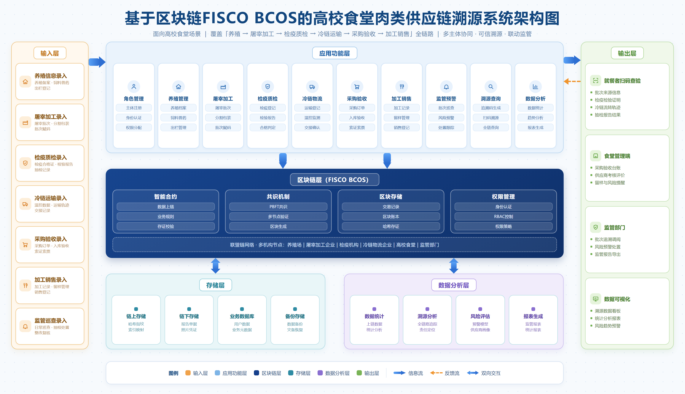

<div align="center">

# 高校食堂肉类供应链溯源系统

**用「批次」串起从采购到餐桌的业务链，用「联盟链存证」给关键事件盖一个改不了的章**


</div>

> **求职向入口**：本仓库另含一个可独立运行的 AI 子项目
> [Trusted RAG · 可信溯源问答](trusted-rag/README.md) — 零 API Key、一条命令复现 20 条评测，
> 只回答链上核验一致的消息、答不出就拒答；[在线演示页](trusted-rag/index.html)。
> 岗位导向的说明与面试追问见 [AI 岗位求职项目包](docs/career/AI岗位求职项目包.md)，
> **可直接复制的简历成稿**见 [简历项目经历 · 定稿](docs/career/简历项目经历-定稿.md)。
> **在线 Demo**：https://trusted-rag-trace.app.workbuddy.host/?sharecode=6TQLACPETO

---

## 这个项目在解决什么问题

高校食堂的肉来自多个供应商、多个批次。一批餐食可能对应好几张检疫合格证。现在的做法是纸质台账或电子表格——

- **能记录，但没法核对**：谁都能改，改完看不出来
- **有追溯码，但没有链路**：扫码只跳到一张静态图片，看不出上下游批次关系
- **出了问题说不清**：`用了猪肉 80 斤`，但这 80 斤是哪批的？

本系统做三件事：

1. **建链路**：一个加工批次可以消耗多个采购批次，每个来源投了多少都记下来，且总量受可用量约束
2. **留指纹**：关键事件规范化后算 SHA-256，摘要上链。任何人可随时重算比对
3. **说清楚结论**：公开页把「**记录核验状态**」和「**检验结论**」分成两块展示，绝不合并

> 技术上能证明的是「这条记录写入后没被改过」，不是「这批肉合格」。把两者混为一谈，才是真的不专业。

---

## 系统架构



六层：输入层 → 应用功能层 → 区块链层 → 存储层 / 数据分析层 → 输出层。详见 [`docs/tech/01-架构总览.md`](docs/tech/01-架构总览.md)。

---

## 核心设计

### 链上只存三要素

```
eventId (bytes32) + batchId (string) + dataDigest (bytes32)
```

业务明细留在 MySQL。原因是成本与隐私：全量上链五年要 GB 级空间，换来的只是省一次数据库查询。**存证要的是防篡改，不是异地备份。**

### 摘要规范化

固定 8 行、字段顺序不可变、数量定点 3 位小数、时间 ISO-8601 带时区、JSON 键名升序无空格：

```
v1
eventId:6f1c2b9a…0718
batchId:PB20261118001
eventType:ACCEPT_RESULT
bizTime:2026-11-18T09:30:00+08:00
quantity:120.000
unit:kg
payload:{"acceptNo":"AC20261118001","certComplete":true,…}
```

→ `SHA-256` → `16decfa5e4ccb17cc948c8d3b44c59439fcd7244e2280a0a6cf5a5f86bc770bf`

这条基准向量写死在单元测试里。规范化逻辑一改，测试就红。详见 [`docs/tech/04-合约设计.md`](docs/tech/04-合约设计.md) 第 5 节。

### 四类核验状态

| 状态 | 判定 | 页面表达 |
|---|---|---|
| `MATCHED` | 链上摘要 == 本地重算 | 绿色「记录已核验」 |
| `MISMATCHED` | 链上有记录但摘要不同 | 红色「记录不一致，请谨慎采信」 |
| `UNCONFIRMED` | 有快照，链上无记录 | 灰色「存证确认中」 |
| `UNREACHABLE` | 查询超时 | 黄色「暂无法核验」 |

第四类必须单独分出来——否则链挂了会被误读成"数据造假"。

### 幂等的两个层次

| 层次 | 手段 | 解决什么 |
|---|---|---|
| 业务层 | `X-Request-Id` + 24h 去重 | 前端重试不产生脏数据 |
| 存证层 | 合约内 `eventId + digest` 判重 | 网络重试不重复上链 |

同内容返回 `1`（幂等），异内容返回 `2`（冲突）并**保留原记录**——允许覆盖就等于给篡改开门。

---

## 功能

| 模块 | 能力 | 状态 |
|---|---|---|
| 供应商管理 | 备案、资质、状态（正常/暂停/黑名单） | ✅ 已实现 |
| 采购批次 | 一批一档，检疫证、屠宰批次、到货温度 | ✅ 已实现 |
| 入库验收 | 感官 / 票证 / 温度 / 留样，判定合格与否 | ✅ 已实现 |
| 存证管理 | 任务状态、手动重试（先查链再决定） | ✅ 已实现 |
| 公开溯源 | 扫码 / 输码，时间线 + 四类核验 + 检验结论分栏 | ✅ 已实现（免登录独立页面） |
| 管理端前端 | 登录 + 布局壳 + 8 个业务页面 | ✅ 已实现（Vue 3 + Element Plus） |
| 冷链登记 | 运输温控，按品类阈值判定，超限自动开异常工单 | ✅ 已实现 |
| 加工投料 | **多来源投料**：来源可多批、数量乐观扣减、并发安全 | ✅ 已实现 |
| 上架 | 加工批次 `CREATED → ON_SALE`，重复上架幂等 | ✅ 已实现 |
| 销售登记 | 按加工批次销售，条件扣减余量，卖完自动 `SOLD_OUT` | ✅ 已实现 |
| 异常处置 | 登记即冻结在售批次，处置可恢复；两次 `DISPOSAL` 事件留痕 | ✅ 已实现 |
| 召回 | 批次 `RECALLED` + 全部销售记录联动标记 + `RECALL` 事件 | ✅ 已实现 |
| 溯源问答 | RAG，答案强制回引事件 ID | ⬜ **未实施**（任务书外扩展，如实标注；见 `TECH-08` §3.1） |

---

## 技术栈

**前端**：Vue 3 · Vite · Element Plus · Pinia · Axios
**后端**：Java 21 · Spring Boot 3.3 · MyBatis-Plus · HikariCP · Flyway · Lombok
**存储**：MySQL 8.0 ·（文件凭证存本地磁盘）
**区块链**：FISCO BCOS 3.17（Air 四节点，`group0`）· Solidity 0.8.11 · WeBASE 3.1.1（Front `/trans/handleWithSign` + Sign 外部签名）
**AI**：RAG（embedding + 内存余弦检索 + 引用回链），可一键关闭

> **读写分工**：写走 WeBASE-Front + WeBASE-Sign（私钥托管、统一演示账户），读走节点标准 `eth_call`（免交易、毫秒级）。
> 不引 `fisco-bcos-java-sdk`：它与 Druid 有版本冲突历史，且升级会牵动整棵依赖树；后端只依赖 HTTP 客户端。
> 读路径之所以不走 WeBASE，是因为 Front 3.1.1 的 `query-transaction` 在 solc 0.8 ABI 下必现空指针——定位与绕开过程记录在 [链环境实测记录](docs/tech/10-链环境实测记录.md) 第 5 节。

---

## 快速开始

```bash
# 1. 启动联盟链（虚拟机内，四节点）
bash nodes/127.0.0.1/start_all.sh

# 2. 确认 WeBASE 在跑（压缩包部署，不是 Docker）
curl -s http://192.168.239.130:5002/WeBASE-Front/group0/web3/blockNumber
curl -s -X POST http://192.168.239.130:8545 -H "Content-Type: application/json" \
     -d '{"jsonrpc":"2.0","method":"eth_blockNumber","params":[],"id":1}'

# 3. 建库（Flyway 会自动建表并导入演示数据）
mysql -u root -p --default-character-set=utf8mb4 \
  -e "CREATE DATABASE meat_trace DEFAULT CHARSET utf8mb4;"

# 4. 后端
cd backend && mvn package -DskipTests
java -jar target/meat-trace-0.1.0.jar --spring.profiles.active=dev

# 5. 前端（另开一个终端）
cd frontend
npm install --registry=https://registry.npmmirror.com
npm run dev
```

后端 `http://localhost:8080`，前端 `http://localhost:5173`，账号 `admin / Admin@123`。
登录页可以直接点演示账号卡片一键填充；**公开溯源页免登录**，直接访问
`http://localhost:5173/trace/PB20261118001`，或用管理员账号 `admin / Admin@123`。

```bash
# 公开溯源（免登录，扫码看到的就是这个）
curl -s "http://localhost:8080/api/public/trace/PB20261118001" | python -m json.tool
curl -s "http://localhost:8080/api/public/trace/PR20261118001" | python -m json.tool
```

> 前端开发期用 Vite 把 `/api` 反代到 8080，不需要配 CORS；后端另有一份 `CorsConfig`
> 兜底，供打包后分离部署或局域网 IP 直连演示。前端完整使用说明见
> [`docs/product/07-前端使用与演示指南.md`](docs/product/07-前端使用与演示指南.md)。

> **不要用 `mvn spring-boot:run`**：仓库路径含中文时 classpath 解析会抛 `ClassNotFoundException`，一律用 `mvn package` + `java -jar`。
> 演示数据已内置：3 家供应商、4 个采购批次、3 个加工批次（含一条多来源投料）、4 笔销售、1 条冷链超限拒收闭环。其中 `PB20261118001` 的验收事件**链上真实存在**，导入后公开溯源直接返回 `MATCHED`。

---

## 一条命令自检

```bash
python scripts/smoke_test.py
```

它会自己起一个实例（18099 端口），跑完 107 项断言后关掉，约 60 秒。覆盖：

```
登录 → 错误口令被拒 → 建供应商 → 建采购批次 → 同 requestId 重放（幂等）
→ 等上链确认 → 验收登记 → 重复验收被拒 → 公开溯源 2 条 MATCHED
→ 仅核验接口 → 演示批次核验 → 不存在批次返回 40401
→ 加工投料（单来源 TC-12 / 多来源 TC-13）→ 上架（幂等）
→ 四类拒绝：来源未验收 40902 / 超量 40901 / 重复引用 40904 / 产出>投入 40001
→ 失败请求全部回滚（批次总数不变）→ PR 追溯码回溯上游 5 条事件全部 MATCHED
→ 销售登记（TC-18）→ 同 requestId 重放不重复卖 → 未上架 40902 / 超量 40901
→ 卖完自动 SOLD_OUT（TC-21）→ 召回联动 3 笔销售全置 RECALLED（TC-24）→ 召回后禁售 40902
→ 冷链 3.00℃ 不超限 / 6.50℃ 超限自动开异常单（TC-10/11）
→ 异常登记冻结 ABNORMAL → 冻结期禁售 → 处置恢复 ON_SALE（TC-22/23）
→ 新事件全部上链 → 公开页时间线含销售与召回且全部 MATCHED
```

链没开时加 `--skip-chain` 只验业务；已有实例在跑时用 `--base-url http://127.0.0.1:8080` 复用。

**跑通它 = 业务链路、摘要规范、上链、幂等、多来源数量约束、四类核验同时都是好的。** 任何一处坏了都会红。

### 并发扣减验证（多来源投料的硬证据）

```bash
python scripts/concurrency_check.py
```

库存 60.000 kg，4 个请求**同时**各申请 20.000 kg。预期恰好 3 个成功、1 个返回 `40901`、
余量精确归零、批次自动结案 `CLOSED`，且三个成功的批次拿到三个**不同**的 `PR` 号。

这个脚本存在的理由：预校验（先查余量再比较）在并发下必然失效，真正兜底的是
`UPDATE … WHERE available_qty >= ?` 的受影响行数。跑一遍，这句话就从"设计如此"变成"实测如此"。

### 逐条验收取证（阶段 E）

```bash
# 需要带 pymysql 的 Python 环境（本机隔离 venv 已装）
python scripts/acceptance_test.py
```

它会依次起四个场景实例（正常 / 关闭工作器 / 链不可达 / 恢复正常），
把 `TECH-07` 里未回填的用例逐条跑一遍，产出：
`TC-*.txt` 接口原文、`TC-32~35.png` 四类核验页面截图、20 次性能采样，
以及 `screenshots/04-接口与日志/acceptance-report.json` 结构化汇总。
页面截图由 `frontend/scripts/capture-evidence.mjs` 经 CDP 注入登录态后拍摄。

```bash
python scripts/acceptance_test.py --skip-screenshots   # 只跑接口，不启动浏览器
```

## 单元测试

```bash
cd backend && mvn test -DforkCount=0
```

必须加 `-DforkCount=0`：仓库路径含中文时 surefire 的 fork 进程起不来
（`The forked VM terminated without properly saying goodbye`）。

当前 49 项：`VerifyStatusResolverTest`（四类状态判定，7）、`ChainCodecTest`（ABI 编码，5）、
`DigestUtilTest`（含金标准向量与 eventId 格式，5）、`RpcReadClientChainTest`（连真链，3）、
`ProcessRulesTest`（投料校验，9）、`SaleRulesTest`（销售状态与余量，9）、
`AbnormalRulesTest`（异常冻结与处置，4）、`ColdChainRulesTest`（品类阈值与分级，4）、
`RecallRulesTest`（可召回状态，3）。

完整步骤与排障见 [`docs/product/03-部署演示指南.md`](docs/product/03-部署演示指南.md)。

---

## 目录结构

```
├─ backend/          Spring Boot 服务（module / chain / assistant 三层分包）
├─ frontend/         Vue 3 管理端 + 公开溯源页
├─ contract/         TraceRegistry.sol + ABI/BIN 产物
├─ db/migration/     Flyway：V1 建表 / V2 补表 / V3 演示数据 / V4–V5 修正与幂等 / V6 发号器
├─ data/knowledge/   问答知识库原文与评测集
├─ docs/             产品文档 + 技术文档（详见下方索引）
├─ scripts/          链检查、合约部署、演示数据重置
└─ screenshots/      运行截图（论文与 README 取材）
```

---

## 文档索引

### 产品文档

| 文档 | 内容 |
|---|---|
| [需求规格说明书](docs/product/01-需求规格说明书.md) | 痛点、角色权限、12 个功能模块、15 条业务规则、12 项验收标准 |
| [用例说明](docs/product/02-用例说明.md) | 12 个核心用例（前置/主流程/异常/后置）+ 用例-测试映射 |
| [部署演示指南](docs/product/03-部署演示指南.md) | 从零到可演示，含 8 条 FAQ |
| [答辩操作手册](docs/product/04-答辩操作手册.md) | 15 分钟逐分钟脚本、关键话术、12 个高频问答 |
| [快速开始](docs/product/05-快速开始.md) | 10 分钟跑通 |
| [AI 问答功能说明](docs/product/06-AI问答功能说明.md) | 能力边界、三种兜底、评测指标 |
| [前端使用与演示指南](docs/product/07-前端使用与演示指南.md) | 启动命令、页面与接口对照、15 分钟答辩演示脚本、四类状态演示方法、FAQ |

### 技术文档

| 文档 | 内容 |
|---|---|
| [架构总览](docs/tech/01-架构总览.md) | 六层架构、选型理由、三条数据流、5 条设计取舍 |
| [数据库设计](docs/tech/02-数据库设计.md) | 10 张表完整 DDL、ER 图、状态字典、事务边界、15 条业务规则 |
| [接口文档](docs/tech/03-接口文档.md) | 统一返回体、14 个错误码、28 个接口 |
| [合约设计](docs/tech/04-合约设计.md) | 合约源码、摘要规范、幂等与冲突、基准向量 |
| [环境版本清单](docs/tech/05-环境版本清单.md) | 组件、版本、校验命令 |
| [配置说明](docs/tech/06-配置说明.md) | 配置项表、密钥与证书管理 |
| [测试用例表](docs/tech/07-测试用例表.md) | 38 项用例，**实际列已全部回填**（35 通过 / 3 未实施） |
| [测试记录](docs/tech/08-测试记录.md) | 执行环境、四场景故障注入、缺陷记录、3 组 × 20 次耗时采样、论文素材索引 |
| [AI 模块设计](docs/tech/09-AI模块设计.md) | 知识库构建、检索、Prompt、引用回链、评测 |
| [链环境实测记录](docs/tech/10-链环境实测记录.md) | P0 环境体检、真实上链证据、已发现的接口缺陷 |
| [落地实施计划](docs/tech/11-落地实施计划.md) | 现状盘点与缺口、GitHub 可复用资产、8 周排期、关键决策点 |

---

## 测试

**已有**：49 项单元测试 + 107 项全链路回归断言（`scripts/smoke_test.py`）
+ 12 项并发扣减验证（`scripts/concurrency_check.py`）
+ **21 条阶段 E 验收断言**（`scripts/acceptance_test.py`，四场景故障注入，196 s）。

`TECH-07` 的 38 项用例中，**已实施的 35 项全部通过**，3 项 AI 问答扩展如实标「未实施」。
四类核验状态（`MATCHED` / `MISMATCHED` / `UNCONFIRMED` / `UNREACHABLE`）**各有一张页面截图**，
接口类用例留有请求/响应原文，结构化汇总在 `screenshots/04-接口与日志/acceptance-report.json`。

**性能实测（20 次采样 × 3 组，预热 3 次不计入）**：

| 接口 | 链查询次数 | 均值 | P95 | 最大 |
|---|---|---|---|---|
| 批次详情（纯数据库） | 0 | 10.4 ms | 18.6 ms | 27.2 ms |
| 公开溯源（1 条事件） | 1 | 27.0 ms | 43.3 ms | 44.5 ms |
| 公开溯源（上溯上游，9 条事件） | 9 | 105.1 ms | 128.1 ms | 161.4 ms |

单次链上 `eth_call` 约 10.5 ms，是端到端耗时的主导项；链不可达时因熔断只超时一次（57.9 ms 返回）。
完整样本、统计口径与边界声明见 `TECH-08` 第 4 节。**这不是压测，不推断高并发能力。**

---

## 关于 AI 模块

问答模块是**主线之外的扩展**：任务书和开题报告里都没有这一项。
`TECH-09` / `PROD-06` 写了完整设计，`kb_chunk` 表也已建好，但**问答服务未实装**，
`TECH-07` 的 TC-36~38 如实标注「未实施」，没有编造通过记录。

设计上它只做一件事：把「已经上链且核验一致」的事件变成可问的知识库，答案强制回引事件 ID；
核验不一致或链不可达的批次不进入知识库。**这部分不影响溯源主流程的完整性。**

> 取舍理由：优先把存证闭环、四类核验、幂等与冲突这些任务书硬验收点做成可验证的真链证据，
> 而不是堆一个不在验收范围内的模块。答辩话术见 `TECH-08` §3.1。

---

## 路线图

- [x] 设计基线冻结（数据库 / 接口 / 合约 / 状态机）
- [x] P0 链环境打通（四节点 + WeBASE-Front）—— 实测记录见 [TECH-10](docs/tech/10-链环境实测记录.md)
- [x] P1 存证闭环 —— 写入走 `ChainWriteClient` + `EvidenceWorker`，真实 txHash 落库；读走节点 `eth_call`
- [x] P2 业务域完整（15 条业务规则）—— 供应商 / 采购 / 验收 / 加工 / 销售 / 冷链 / 异常 / 召回 全部完成
- [x] P3 前端页面 + 公开溯源页 —— 登录 / 布局壳 / 8 个业务页面 / 免登录溯源页全部完成，2026-11-18 实机联调通过
- [x] P4 测试用例回填 + 性能采样 —— **35 项已实施用例全部通过**（四类核验均有截图）、3 组 × 20 次耗时采样完成，详见 `TECH-08`
- [x] P4.5 文档口径同步 —— `TECH-10` §6 的 7 处全部对齐实测链环境（3.17.0 / group0 / solc 0.8.11 / WeBASE 3.1.1）
- [ ] P3.5 问答模块（**任务书外扩展，已决定不做**；论文按「设计了、未实现」如实写）
- [ ] P5 论文初稿（截止 2027-01-11）

---

## 作者

**张育茂** · 江西工程学院 · 智慧产业学院 · 区块链工程 2023 级（2027 届）
毕业设计《高校食堂肉类供应链溯源系统设计与实现》· 指导教师：何云松

## 许可

[MIT](LICENSE)
