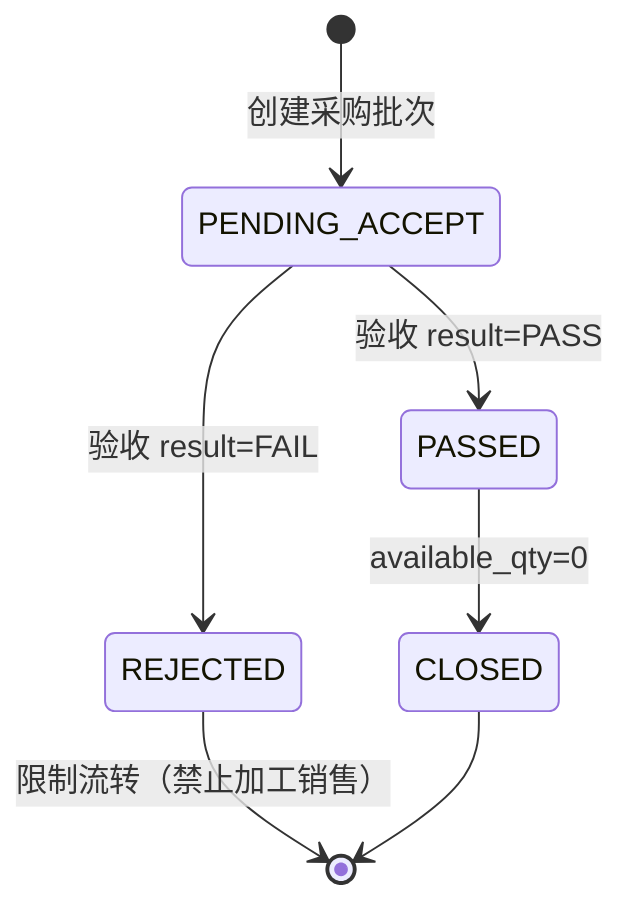
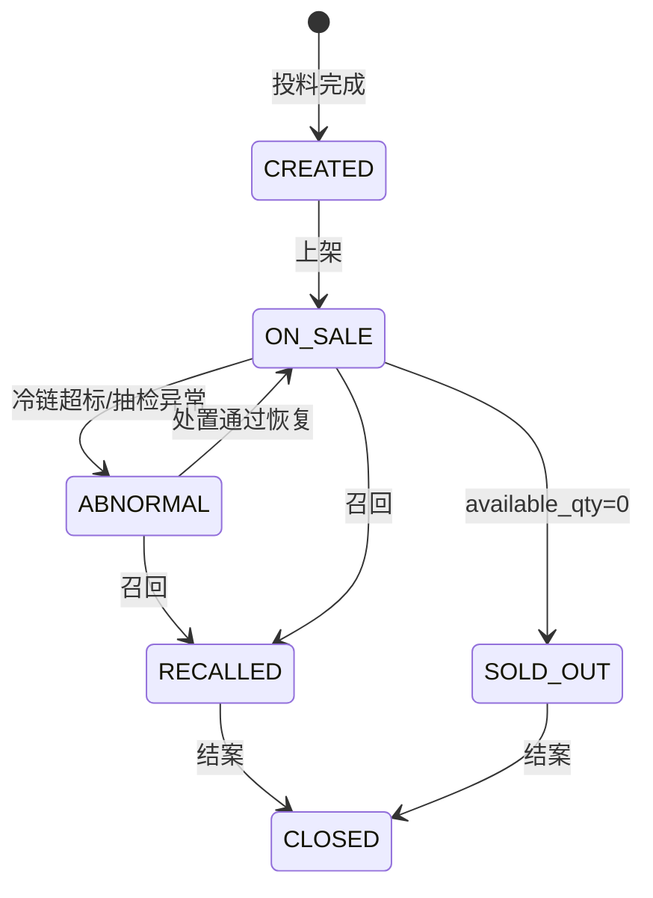
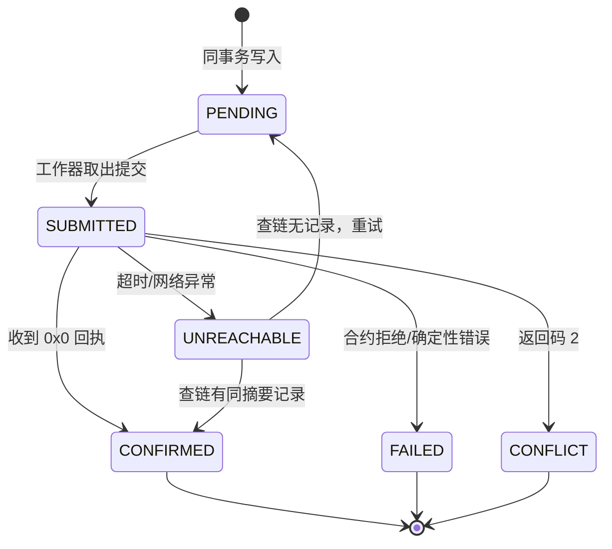

# 需求规格说明书

> 文档编号：PROD-01 ｜ 版本：v1.0 ｜ 定稿：2026-11-18
> 项目：高校食堂肉类供应链溯源系统设计与实现
> 依据：`D:\毕业论文\01_过程材料\_预览\张育茂-任务书_终稿_20261101.pdf`
> 服务论文：第 3 章 需求分析与业务建模（3.1–3.4）

---

## 1 引言

### 1.1 编写目的

把任务书中已经确定的系统要求，翻译成可开发、可测试、可验收的规格条目。本文档是数据库设计、接口设计、测试用例与论文第 3 章的共同上游。

### 1.2 项目背景

高校食堂肉类采购来自多家供应商、多个批次。一批餐食可能对应多张检疫合格证与多份检验报告。传统做法依赖纸质台账与电子表格，能完成"存"，但完成不了"核"：

- 各环节编码不统一，来源链路需要人工汇总
- 追溯码只提供查询入口，不建立上下游批次关系
- 数据由单方维护，改动无痕，事后难以判断哪一版是真的

本系统不试图解决"数据是否真实"（那是监管与制度的责任），而是解决**"这条记录在写入之后有没有被改过"**——这是技术可以兑现的承诺。

### 1.3 术语

| 术语 | 含义 |
|---|---|
| 采购批次 | 一次采购到货形成的最小业务单元，编号 `PB` + 日期 + 序号 |
| 加工批次 | 一次投料加工形成的成品单元，编号 `PR` + 日期 + 序号，**即追溯码** |
| 来源关系 | 加工批次与采购批次之间的多对多消耗关系，含投入数量 |
| 事件 | 一次值得留痕的业务动作（采购/验收/冷链/加工/销售/处置/召回） |
| 事件快照 | 事件的规范化数据副本，是计算摘要与核验的依据 |
| 数据摘要 | 事件快照规范化文本的 SHA-256，64 位小写 hex |
| 核验状态 | 链上摘要与本地重算摘要的比对结果（四类） |
| 检验结论 | 检疫/验收给出的质量判定（合格/不合格），与核验状态**无关** |

### 1.4 范围边界

**在范围内**：供应商备案、采购批次、入库验收、冷链登记、加工投料（多来源）、留样、销售登记、异常处置、召回、事件存证、公开溯源、溯源问答。

**不在范围内**：真实温控硬件、在线支付、单品防伪、跨机构独立签名、高并发压测、生产环境接入。

> 这条边界要写进论文，避免评审以"功能不全"为由质疑。边界清晰本身就是工程能力的体现。

---

## 2 业务痛点与解决思路

| # | 痛点 | 现状 | 本系统的做法 |
|---|---|---|---|
| P1 | 批次来源关联不完整 | 加工记录只写"用了猪肉 80 斤"，不写来自哪批 | 建立 `source_relation`，强制记录每个来源批次的投入数量，且总量受可用量约束 |
| P2 | 业务记录难以核对 | 数据库可被任何有权限的人修改，改完无痕 | 关键事件计算摘要上链，任何人可随时重算比对 |
| P3 | 异常处置展示不清晰 | 出了问题只能口头说明"已处理" | 处置与召回作为独立事件留痕，公开页可见全链路 |
| P4 | 追溯码沦为摆设 | 扫码只跳到一张静态图片 | 二维码只作入口，落地页展示真实业务时间线与核验状态 |
| P5 | 核验与质量被混为一谈 | 页面写"区块链已验证，请放心食用" | 强制分栏：核验状态说"记录没被改"，检验结论说"肉合不合格" |

**P5 是本项目在需求阶段最重要的一个判断**。技术上能证明的是"记录完整性"，不是"食品安全性"。把两者混在一起，既误导用户，也会在答辩时被一句话问倒。

---

## 3 角色与权限

| 角色 | 代码 | 说明 | 可见数据 | 可写操作 |
|---|---|---|---|---|
| 统一管理员 | `ADMIN` | 食堂管理员，演示环境下统一完成各环节录入 | 全部 | 全部写操作 |
| 供应商主体 | `SUPPLIER` | 供货方，作为业务主体保存资料 | 仅自己相关的采购批次 | 无写权限（演示阶段） |
| 公开查询者 | 匿名 | 师生、家长、监管人员 | 仅公开溯源页 | 无 |
| 只读监管 | `VIEWER` | 监管人员账号（可选） | 全部只读 + 统计 | 无 |

**为什么把供应商设为只读**：任务书写明"后台由统一管理员完成演示录入，供应商作为业务主体资料保存"。这是为了在单机演示环境下保证数据一致性，同时保留多主体模型的结构。论文里要写清楚这是演示约束，不是架构缺陷。

**权限矩阵**

| 功能 | ADMIN | SUPPLIER | VIEWER | 匿名 |
|---|---|---|---|---|
| 供应商备案 | 增删改查 | 查看自己 | 查看 | — |
| 采购批次 | 增改查 | 查看自己 | 查看 | — |
| 验收登记 | 增查 | 查看自己 | 查看 | — |
| 加工投料 | 增查 | — | 查看 | — |
| 销售登记 | 增查 | — | 查看 | — |
| 异常处置/召回 | 增查 | — | 查看 | — |
| 存证管理 | 查看/重试 | — | 查看 | — |
| 公开溯源 | ✓ | ✓ | ✓ | ✓ |
| 溯源问答 | ✓ | ✓ | ✓ | — |

---

## 4 功能需求

### 4.1 模块清单

| 编号 | 模块 | 优先级 | 核心能力 | 验收点 |
|---|---|---|---|---|
| F1 | 供应商管理 | P0 | 备案、资质、状态变更 | 状态为 `BLACKLISTED` 时禁止新建采购单 |
| F2 | 采购批次 | P0 | 建批次、检疫证登记、数量管理 | 批次号唯一；可用量不超过采购量 |
| F3 | 入库验收 | P0 | 感官/票证/温度/留样判定 | 不合格批次状态变 `REJECTED` 且无法加工 |
| F4 | 冷链登记 | P1 | 运输温控记录 | 超阈值触发 `COLD_CHAIN` 异常事件 |
| F5 | 加工投料 | P0 | 多来源投料、留样编号 | 投入 ≤ 可用；同批次不得重复引用 |
| F6 | 销售登记 | P0 | 按加工批次销售 | 未上架不可售；累计不超产 |
| F7 | 异常处置 | P1 | 异常登记、处置结论 | 处置后批次可冻结 |
| F8 | 召回 | P0 | 按加工批次召回 | 召回后全部销售记录置 `RECALLED` |
| F9 | 存证管理 | P0 | 任务查看、手动重试、回执 | 四类状态可区分；重试前先查链 |
| F10 | 公开溯源 | P0 | 时间线、核验状态、检验结论 | 四类核验状态各可演示 |
| F11 | 数据分析 | P2 | 批次统计、供应商画像 | 数据与业务表一致 |
| F12 | 溯源问答 | P2 | 自然语言查询 + 引用回链 | 无依据时不编造 |

> P0 = 初稿前必须完成；P1 = 定稿前完成；P2 = 加分项，可裁。

### 4.2 关键功能描述

**F3 入库验收**
输入：批次、验收人、到货温度、感官结论、票证齐全性、留样。
规则：任一项不满足 → `result=FAIL`，必须填原因；判定结果直接决定该批次能否进入加工。
输出：验收记录 + 批次状态迁移 + `ACCEPT_RESULT` 事件。

**F5 加工投料**
输入：品类、加工时间、档口、操作人、留样编号、产出量、来源列表（批次号 + 投入量）。
规则：见 `TECH-02` 第 8 节 BR-01~BR-05。
输出：加工批次 + 来源关系 + `PROCESS_CREATE` 事件（payload 内含 `sources[]`）。

**F9 存证管理**
输入：任务状态筛选。
能力：查看每条事件的任务状态、重试次数、错误信息；手动重试。
规则：重试前必须先按 `eventId` 查链（BR-14）；`CONFLICT` 状态不允许自动重试。

**F10 公开溯源**
输入：批次号（扫码进入时为 URL 参数）。
输出：批次概要 + 供应方 + 来源合计 + 事件时间线（每条带核验状态）+ 检验结论 + 核验汇总。
规则：核验状态与检验结论分栏；`MISMATCHED` 用红色显著提示；`UNREACHABLE` 明确写"暂无法核验"而非"通过"。

---

## 5 非功能需求

| 编号 | 类别 | 要求 | 验证方式 |
|---|---|---|---|
| N1 | 可读性 | 公开页在手机端 375px 宽度下无需横向滚动；核验状态用文字而非仅颜色表达 | 真机/模拟器截图 |
| N2 | 稳定性 | 常规操作（新增/查询）连续 20 次无失败 | 测试用例 TC-28 |
| N3 | 可复现 | 从零到可演示，按部署文档 ≤ 60 分钟 | 冷机重装验证 |
| N4 | 失败可辨识 | 任何失败必须给出明确状态与原因，不允许"静默成功" | 错误码清单 + 测试用例 |
| N5 | 响应 | 公开溯源页 ≤ 1.5s（不含首次链查询）；含链查询 ≤ 3s | 20 次采样 |
| N6 | 数据一致 | 业务/快照/任务三写入同事务，不允许部分成功 | 事务回滚测试 |
| N7 | 安全 | 口令 BCrypt 存储；私钥与密钥不入库、不入 Git | 代码审查 + `.gitignore` 检查 |
| N8 | 可维护 | 所有配置项外置；日志含 traceId | 配置检查 |

---

## 6 业务规则与状态机

### 6.1 采购批次状态机

### 6.2 加工批次状态机

### 6.3 存证任务状态机

### 6.4 业务规则

完整 15 条见 `docs/tech/02-数据库设计.md` 第 8 节（BR-01 ~ BR-15）。需求层只强调三条最重要的：

- **BR-02 数量约束**：投入不得超过可用。这是"来源关系"能成立的前提。
- **BR-12 冲突不覆盖**：允许覆盖就等于给篡改开了门。
- **BR-15 核验与结论分栏**：这是产品层面的红线。

---

## 7 数据需求

核心实体 10 张表，字段与约束见 `docs/tech/02-数据库设计.md` 第 3–5 节。需求层只约定三件事：

1. 数量一律 3 位小数的定点值，禁止浮点
2. 所有业务表必须有 `created_at`，关键表有 `updated_at`
3. 存证相关表（`event_snapshot` / `evidence_task` / `tx_receipt`）与业务表**不做外键关联**——因为存证要保持独立可核验，不能被业务表的删除级联影响

---

## 8 验收标准

对应任务书"预期成果"与"验收依据"，逐条落成可检查项：

| # | 验收项 | 判定标准 |
|---|---|---|
| A1 | 六环节正常流程 | 采购 → 验收 → 冷链 → 加工 → 销售 → 查询，全链路可演示且数据自洽 |
| A2 | 多来源加工 | 至少一个加工批次关联 **≥2** 个采购批次，页面显示各来源投入量 |
| A3 | 数量约束 | 超量投料、超量销售均被拒绝并给出剩余可用量 |
| A4 | 异常拦截 | 验收不合格批次无法进入加工；未上架无法销售 |
| A5 | 召回联动 | 召回后该批次销售记录全部置 `RECALLED`，页面可见 |
| A6 | 事件可核对 | 任取一条 `CONFIRMED` 事件，可重算摘要并与链上一致 |
| A7 | 四类核验状态 | `MATCHED` / `MISMATCHED` / `UNCONFIRMED` / `UNREACHABLE` 均有测试证据 |
| A8 | 幂等 | 重复提交同一事件，链上记录数不增加 |
| A9 | 测试记录 | ≥30 项用例，含前置/输入/预期/实际/证据位置 |
| A10 | 响应数据 | 公开查询与批次详情各 20 次采样，报均值与最大值 |
| A11 | 文档完整 | 环境版本、配置项、迁移、部署、演示数据、答辩指南齐备 |
| A12 | 问答可追溯 | 每个答案至少 1 条引用；无依据时明确说"未找到依据" |

---

## 9 需求追踪矩阵

| 需求 | 用例 | 测试用例 | 论文节 |
|---|---|---|---|
| F1 供应商 | UC-01 | TC-01, TC-02 | 3.3 / 5.2 |
| F2 采购 | UC-02 | TC-03~TC-05 | 3.3 / 5.3 |
| F3 验收 | UC-03 | TC-06~TC-09 | 3.3 / 5.4 |
| F4 冷链 | UC-04 | TC-10, TC-11 | 5.5 |
| F5 加工 | UC-05, UC-06 | TC-12~TC-17 | 5.6 |
| F6 销售 | UC-07 | TC-18~TC-21 | 5.7 |
| F7 异常处置 | UC-08 | TC-22, TC-23 | 5.8 |
| F8 召回 | UC-09 | TC-24, TC-25 | 5.8 |
| F9 存证管理 | UC-10 | TC-26~TC-31 | 5.9 / 6.2 |
| F10 公开溯源 | UC-11 | TC-32~TC-35 | 5.10 / 6.2 |
| F12 问答 | UC-12 | TC-36~TC-38 | 5.11 |

> 这张表是答辩时最好用的一页：任何一条需求，都能当场指出它对应哪个用例、哪条测试、论文哪一节。
