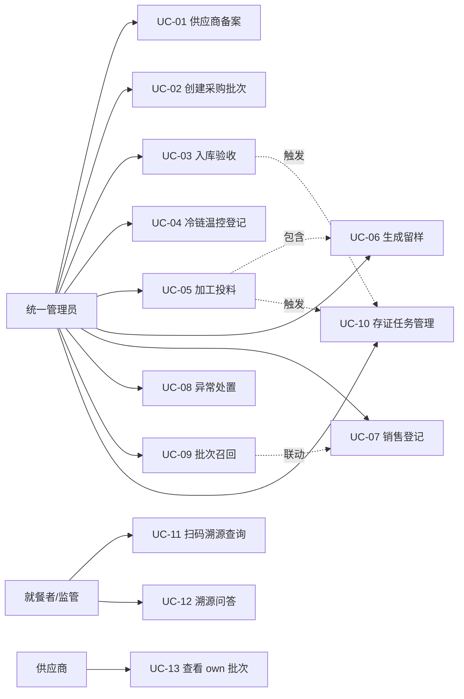
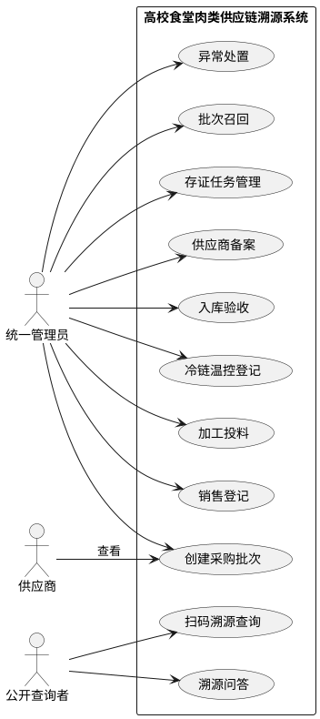

# 用例说明

> 文档编号：PROD-02 ｜ 版本：v1.0 ｜ 定稿：2026-11-18
> 服务文档：3.3 用例分析、6.1 功能测试设计
> 上游：`PROD-01 需求规格说明书` ｜ 下游：`TECH-07 测试用例表`

---

## 1 用例总览

**参与者**：统一管理员（主）、供应商（只读）、公开查询者（匿名）。

---

## 2 核心用例详述

### UC-02 创建采购批次

| 项 | 内容 |
|---|---|
| 参与者 | 统一管理员 |
| 前置条件 | 供应商已备案且状态为 `ACTIVE` |
| 触发 | 在「采购管理」页填写表单并提交 |
| 主流程 | ① 选择供应商 → ② 填写品类/产地/屠宰批次/检疫证号/数量/到货时间/到货温度 → ③ 系统生成 `batch_no` → ④ 落库，状态 `PENDING_ACCEPT` → ⑤ 同事务写事件快照与存证任务 → ⑥ 返回批次号与 `evidence.status=PENDING` |
| 异常分支 | A1 供应商状态为 `BLACKLISTED` → `40902` 拒绝 A2 检疫证号为空 → `40001` A3 数量非 3 位小数 → `40002` A4 同一 `X-Request-Id` 重复提交 → 返回首次结果 `replayed=true` |
| 后置条件 | 批次可被验收；`PURCHASE_CREATE` 事件进入存证队列 |
| 关联规则 | BR-10、BR-13 |

### UC-03 入库验收

| 项 | 内容 |
|---|---|
| 前置条件 | 批次存在且状态为 `PENDING_ACCEPT` |
| 主流程 | ① 选择批次 → ② 录入验收人/实测温度/感官/票证/留样 → ③ 判定 `PASS` 或 `FAIL` → ④ 批次状态迁移 → ⑤ 写 `ACCEPT_RESULT` 事件 |
| 异常分支 | A1 批次已验收 → `40902` A2 `result=FAIL` 未填原因 → `40001` A3 实测温度超出品类阈值 → 允许通过但强制生成 `COLD_CHAIN` 异常事件，UI 二次确认 |
| 后置条件 | `PASS` → 可加工；`FAIL` → 限制流转，加工接口将拒绝 |
| 关联规则 | BR-01、BR-04、BR-08 |

### UC-05 加工投料（多来源）

| 项 | 内容 |
|---|---|
| 前置条件 | 至少 1 个 `PASSED` 且 `available_qty > 0` 的采购批次 |
| 主流程 | ① 选择品类/时间/档口/操作人 → ② 添加来源行（批次号 + 投入量），至少一行 → ③ 填产出量与留样编号 → ④ 提交 → ⑤ 事务内校验（来源状态、重复、余量、产出 ≤ 投入）→ ⑥ 乐观扣减可用量 → ⑦ 生成 `process_no` → ⑧ 写来源关系 → ⑨ 写 `PROCESS_CREATE` 事件（payload 含全部 sources） |
| 异常分支 | A1 来源批次未通过验收 → `40902` A2 同一批次被重复引用 → `40904` A3 投入量 > 可用量 → `40901`，提示剩余可用量 A4 产出量 > 投入总量 → `40001` A5 并发下扣减失败（受影响行数 0）→ 回滚整个事务，`40901` |
| 后置条件 | 加工批次 `CREATED`；来源批次可用量减少；留样可查 |
| 关联规则 | BR-01 ~ BR-05、BR-13 |

> 这是全系统最复杂的一个用例，也是评审最值得讲的一个：它同时体现了**多对多来源建模**、**事务内数量约束**、**并发安全**三件事。

### UC-07 销售登记

| 项 | 内容 |
|---|---|
| 前置条件 | 加工批次状态为 `ON_SALE` 且 `available_qty > 0` |
| 主流程 | ① 扫码或选择加工批次 → ② 填窗口/数量/单价/时间 → ③ 校验累计销量 → ④ 扣减可用量 → ⑤ 写 `SALE_CREATE` 事件 |
| 异常分支 | A1 批次未上架 → `40902` A2 销售量 > 余量 → `40901` A3 批次已召回 → `40902` |
| 后置条件 | 余量为 0 时批次转 `SOLD_OUT` |
| 关联规则 | BR-06、BR-07、BR-09 |

### UC-09 批次召回

| 项 | 内容 |
|---|---|
| 触发 | 抽检异常或监管通知 |
| 主流程 | ① 选择加工批次 → ② 填召回原因/范围/处理人 → ③ 确认二次弹窗 → ④ 事务内：批次 → `RECALLED`，其全部销售记录 → `RECALLED` → ⑤ 写 `RECALL` 事件 |
| 异常分支 | A1 批次已是 `RECALLED` → `40902` A2 该批次无销售记录 → 允许召回，`affectedSales=0` |
| 后置条件 | 该批次不可再售；公开页时间线出现「已召回」节点 |
| 关联规则 | BR-09 |

### UC-10 存证任务管理

| 项 | 内容 |
|---|---|
| 前置条件 | 存在 `PENDING` / `UNREACHABLE` / `CONFLICT` 任务 |
| 主流程 | ① 按状态筛选任务 → ② 查看 `last_error` 与重试次数 → ③ 点「重试」→ ④ 服务端**先按 eventId 查链** → ⑤ 有同摘要记录 → 直接 `CONFIRMED`；无记录 → 重新入队 |
| 异常分支 | A1 任务为 `CONFLICT` → 禁止自动重试，仅提示人工核对 A2 链仍不可达 → 保持 `UNREACHABLE`，刷新 `next_retry_at` |
| 后置条件 | 任务状态与回执一致 |
| 关联规则 | BR-11、BR-12、BR-14 |

### UC-11 扫码溯源查询

| 项 | 内容 |
|---|---|
| 参与者 | 就餐者、家长、监管人员（免登录） |
| 前置条件 | 批次号存在 |
| 主流程 | ① 扫描二维码（内容为 `/trace/{batchNo}`）或手工输码 → ② 页面请求 `/api/public/trace/{batchNo}` → ③ 展示批次概要、供应方、来源合计、检验结论 → ④ 渲染事件时间线，每条带核验徽标 → ⑤ 展示核验汇总（一致/不一致/待确认/不可达计数） |
| 异常分支 | A1 批次号不存在 → `40401`，页面提示"未查询到该批次" A2 链不可达 → 时间线正常展示业务数据，核验徽标显示「暂无法核验」，页面顶部黄色提示条 A3 存在 `MISMATCHED` → 页面顶部红色警示条：「本条记录与链上不一致，请谨慎采信」 |
| 后置条件 | 无（只读） |
| 关联规则 | BR-15 |

### UC-12 溯源问答

| 项 | 内容 |
|---|---|
| 前置条件 | 知识库已构建；用户已登录 |
| 主流程 | ① 输入自然语言问题 → ② 检索 Top-K 事件片段（仅 `MATCHED`）→ ③ 拼 Prompt 调模型 → ④ 返回答案 + 引用列表 → ⑤ 点击引用跳转到对应事件 |
| 异常分支 | A1 检索无结果或相似度低于阈值 → `grounded=false`，答案固定为「未在已核验记录中找到依据」 A2 模型调用失败 → `50003`，降级只返回检索到的片段列表 A3 模块被关闭 → 前端隐藏入口 |
| 后置条件 | 无（只读） |
| 关联规则 | — |

---

## 3 用例与测试映射

| 用例 | 覆盖需求 | 测试用例 | 关键证据 |
|---|---|---|---|
| UC-01 供应商备案 | F1 | TC-01, TC-02 | 供应商列表截图 + 黑名单拦截提示 |
| UC-02 创建采购 | F2 | TC-03 ~ TC-05 | 批次详情 + 成对出现的快照/任务记录 |
| UC-03 入库验收 | F3 | TC-06 ~ TC-09 | 合格/不合格两条路径的批次状态 |
| UC-04 冷链登记 | F4 | TC-10, TC-11 | 温度超标触发的事件记录 |
| UC-05 加工投料 | F5 | TC-12 ~ TC-17 | 多来源明细 + 余量变化前后对比 |
| UC-06 留样 | F5 | TC-16 | 留样编号与加工批次关联 |
| UC-07 销售登记 | F6 | TC-18 ~ TC-21 | 未上架拦截、超量拦截 |
| UC-08 异常处置 | F7 | TC-22, TC-23 | 处置前后状态 |
| UC-09 召回 | F8 | TC-24, TC-25 | 销售记录批量置 `RECALLED` |
| UC-10 存证管理 | F9 | TC-26 ~ TC-31 | 四类核验状态 + 幂等前后记录数 |
| UC-11 扫码溯源 | F10 | TC-32 ~ TC-35 | 四类状态各一张页面截图 |
| UC-12 溯源问答 | F12 | TC-36 ~ TC-38 | 答案 + 引用 + 无依据时的兜底 |

---

## 4 用例图绘制说明（供插图）

用例分析一节需要的 UML 用例图，建议用 PlantUML 绘制（比 Mermaid 的用例图规范）：

> 不要放 Mermaid 源码，要放渲染后的 PNG。用 PlantUML 在线渲染后按 300dpi 导出，插入 `04_文档正文`。
