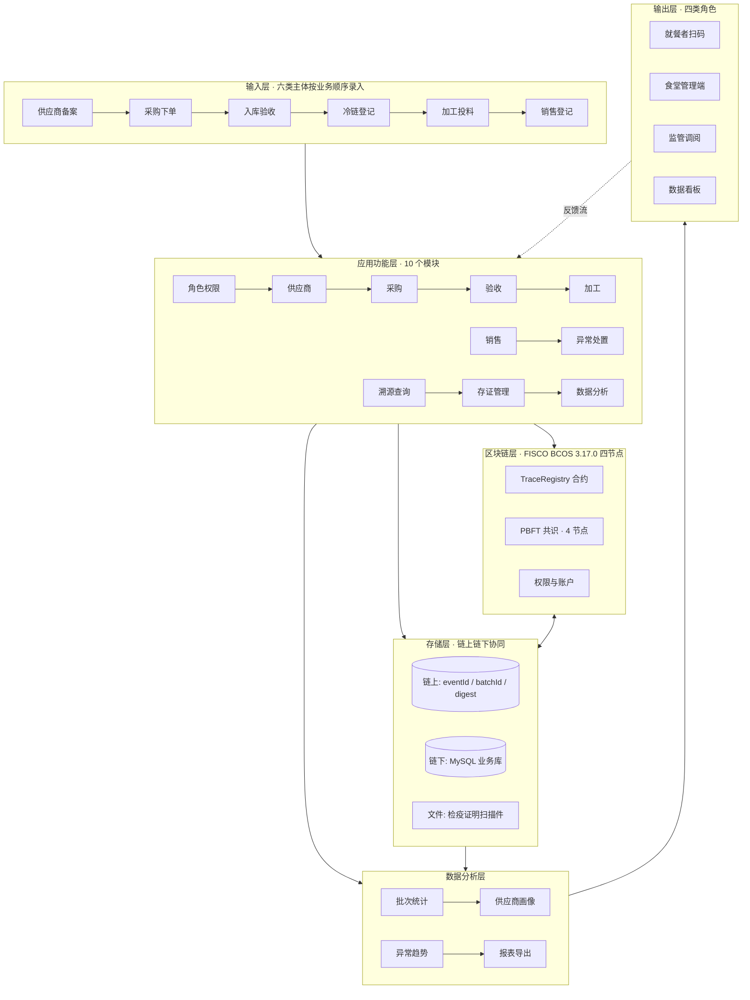
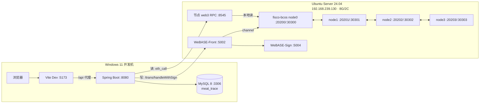
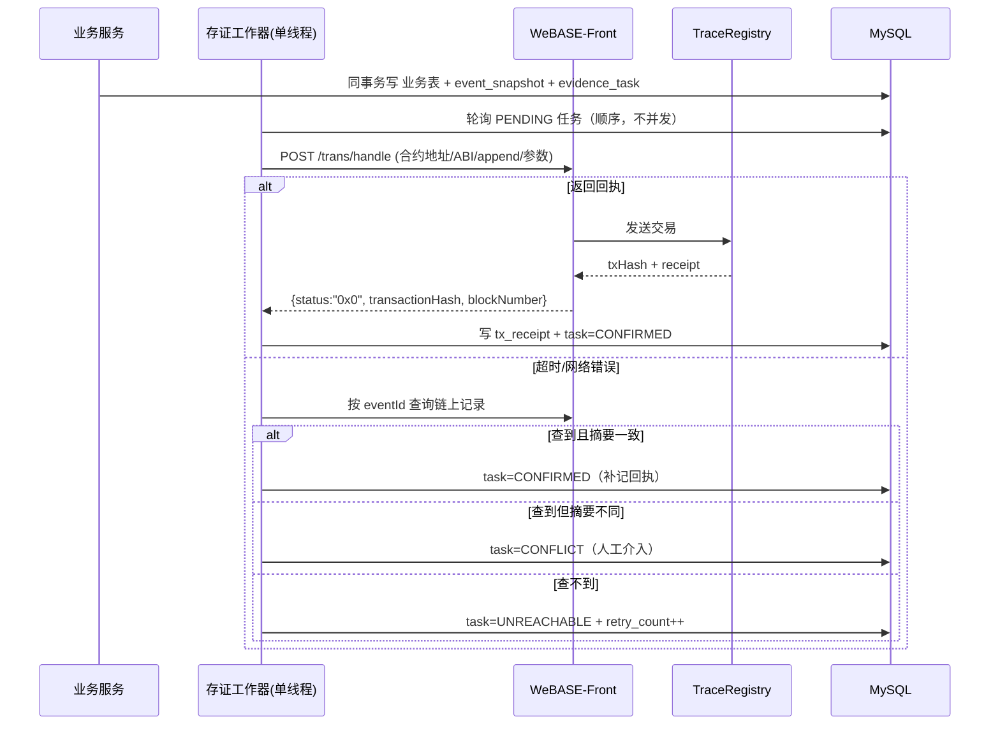

# 系统架构总览

> 文档编号：TECH-01 ｜ 版本：v1.0 ｜ 定稿：2026-11-18
> 读者：开发者、评审、GitHub 访客
> 关联：`TECH-02 数据库设计`、`TECH-03 接口文档`、`TECH-04 合约设计`

---

## 1 系统定位与边界

**一句话**：用「批次」串起高校食堂肉类从采购到餐桌的业务链，用「联盟链存证」给这条链上的关键事件盖一个事后改不了的章，并让就餐者扫码就能看到这批肉的全链路记录与核验状态。

### 1.1 做什么

| 能力 | 说明 |
|---|---|
| 供应商备案 | 主体资质、许可证、状态（正常/暂停/黑名单） |
| 采购批次管理 | 一批一档，承载产地、屠宰批次、检疫合格证、数量 |
| 入库验收 | 索证索票、感官、到货温度，判定合格/不合格 |
| 加工与留样 | 一个加工批次可消耗**多个**采购批次，记录投入数量与留样编号 |
| 销售登记 | 按加工批次销售，累计销量受产出量约束 |
| 异常处置与召回 | 冷链超标、抽检异常触发处置，可召回并联动拦截销售 |
| 事件存证 | 关键事件规范化成快照，计算 SHA-256 摘要后上链 |
| 公开溯源 | 扫码/输码查询全链路，展示**记录核验状态**与**检验结论**两个独立结论 |
| 智能问答 | 基于已核验事件做自然语言问答，答案强制回引事件 ID |

### 1.2 不做什么（明确划线，避免评审被追问）

| 不做 | 原因 |
|---|---|
| 真实传感器/温控硬件接入 | 温度数据人工录入与演示导入，已明确排除 |
| 在线交易支付 | 销售登记只做记录，不接支付 |
| 一物一码防伪 | 追溯码是**批次**查询入口，不是单品防伪 |
| 跨机构独立签名与容灾 | 演示环境为单机多节点，不评价跨机构容灾 |
| 自研共识算法 / 密码学 | 沿用 FISCO BCOS 内置 PBFT 与国密/国际密码套件 |

---

## 2 六层架构



**两条闭环**：

- **数据闭环**：录入 → 业务落库 → 事件快照 → 上链 → 回执 → 公开查询 → 反馈
- **监管闭环**：巡查/抽检 → 异常判定 → 处置 → 召回 → 整改复核

### 2.1 各层落地到哪个代码包

| 层 | 代码位置 | 说明 |
|---|---|---|
| 输入层 | `frontend/src/views/admin/**` | 表单驱动的录入界面 |
| 应用功能层 | `backend/.../module/{supplier,purchase,accept,process,sale,trace,evidence}` | 每个模块含 controller / service / mapper / dto |
| 区块链层 | `contract/TraceRegistry.sol` + `backend/.../chain/` | 合约 + 存证客户端（HTTP 调 WeBASE-Front） |
| 存储层 | `db/migration/*.sql` + `backend/.../module/*/entity` | 链上只存三要素，明细在 MySQL |
| 数据分析层 | `backend/.../module/stats` | 聚合查询，不参与业务写 |
| 输出层 | `frontend/src/views/public/**` | 公开溯源页，免登录 |

---

## 3 技术选型与理由

| 组件 | 选型 | 版本 | 理由 | 被否方案 |
|---|---|---|---|---|
| 前端框架 | Vue 3 + Vite | 3.5 / 6.x | 组合式 API 上手快，Vite 冷启动 <1s；Element Plus 表格表单齐全 | React（生态重，学习曲线陡） |
| UI 库 | Element Plus | 2.8.x | 中后台组件齐、中文文档好 | Ant Design Vue（体积大） |
| 后端框架 | Spring Boot | 3.3.x | 框架选型；Java 21 虚拟线程可直接用于存证轮询 | — |
| ORM | MyBatis-Plus | 3.5.7 | 单表 CRUD 零 SQL，复杂查询仍可写 XML | JPA（复杂查询别扭） |
| 数据库 | MySQL | 8.0.x | 事务 + 外键约束，满足"同事务写入"要求 | PostgreSQL（本机已装 MySQL） |
| 联盟链 | FISCO BCOS | **3.17.0** Air 4 节点 / `group0` | 实测环境就是 3.17.0（需求书写 2.9，见 TECH-10 §1）；国产开源、单机可跑四节点 | 以太坊私链（无准入） |
| 链写入 | WeBASE-Front `POST /trans/handleWithSign` | **WeBASE 3.1.1** | 签名交给 Sign，私钥不进后端；免装 SDK，避开 java-sdk 与连接池的版本冲突 | `fisco-bcos-java-sdk`（Druid 冲突历史） |
| 链读取 | 节点 JSON-RPC `eth_call` :8545 | 节点自带 web3_rpc | 免交易、毫秒级；WeBASE-Front 3.1.1 的 `query-transaction` 在 solc 0.8 ABI 下必现 NPE（TECH-10 §5） | `/trans/query-transaction`、用 `handleWithSign` 代读 |
| 签名 | WeBASE-Sign 外部账户 `meattrace/meattraceadmin` | **3.1.1** | 私钥托管，符合"统一演示账户" | 本地私钥文件 |
| 连接池 | HikariCP | Spring Boot 默认 | 无额外依赖，无冲突 | Druid（与 SDK 冲突历史） |
| 迁移 | Flyway | 10.x | 版本化建表，一键复现 | 手工执行 SQL |
| 文档 | Markdown + Mermaid | — | GitHub 原生渲染，图表可版本化 | Word（不可 diff） |

> **版本策略**：所有版本号写在 `TECH-05 环境版本清单` 中并锁定；`pom.xml` 与 `package.json` 提交 lock 文件，禁止 `latest`。

---

## 4 运行时部署拓扑



**端口约定**：链 p2p 30300-30303、channel 20200-20203、**节点 web3 RPC 8545（node0 已开启）**、WeBASE-Front 5002、WeBASE-Sign 5004、WeBASE-Node-Manager 5001、WeBASE-Web 5000、后端 8080、前端 5173、MySQL 3306（宿主机侧）。

> **读写分工**：写走 Front + Sign（有身份、有签名），读走节点 `eth_call`（免交易）。
> 这是发现 WeBASE-Front 3.1.1 查询接口缺陷后重新划分职责的结果，详见 TECH-10 §5.6。
>
> 单机 2 核跑 4 节点 + 2 个 Java 中间件是紧的。运行顺序：链 → WeBASE → 后端 → 前端；不演示时只留链。

---

## 5 三条数据流

### 5.1 业务流（写库）

```
前端表单 → Controller 校验(Bean Validation) → Service 开启事务
  ├─ 业务规则校验（数量/状态/来源）
  ├─ 写业务表
  ├─ 生成 event_snapshot（规范化 + SHA-256）
  └─ 写 evidence_task(PENDING)
提交事务 → 立即返回业务结果（不等上链）
```

**关键点**：业务成功 ≠ 存证成功。接口返回里明确带 `evidenceStatus` 字段。

### 5.2 存证流（上链）



### 5.3 核验流（读 + 比）

```
公开页请求 batchNo
  → 查 event_snapshot 列表（链下原件）
  → 对每条：重新计算 SHA-256(data_digest 的来源 canonical_text)
  → 调 WeBASE-Front 查链上 record
  → 比对 链上 digest == 重算 digest
  → 得出四类状态之一
```

| 状态 | 判定 | 页面表达 |
|---|---|---|
| `MATCHED` 记录一致 | 链上与链下摘要相同 | 绿色「记录已核验」 |
| `MISMATCHED` 记录不一致 | 同 eventId 但摘要不同 | 红色「记录不一致，请谨慎采信」 |
| `UNCONFIRMED` 尚未确认 | 有快照无回执，或任务未完成 | 灰色「存证确认中」 |
| `UNREACHABLE` 链上不可达 | 查询超时/节点不可用 | 黄色「暂无法核验」 |

> **这条要在页面和评审里反复强调**：核验状态说明的是"**记录有没有被改过**"，检验结论说明的是"**这批肉合不合格**"。两者独立展示，不得互相替代。

---

## 6 关键设计取舍

| # | 取舍 | 原因 | 代价 |
|---|---|---|---|
| 1 | 链上只存 `eventId / batchId / dataDigest` 三要素 | 全量上链成本高、查询慢；存证的本质是"防篡改"不是"存数据" | 查明细必须回链下库，链上无法独立还原业务 |
| 2 | 事件用 **追加** 模型，不做更新/删除 | 溯源要求不可否认；追加天然可审计 | 纠正错误要靠新事件覆盖语义，业务侧要处理"最新有效事件" |
| 3 | 存证异步化（事务内只写任务） | 上链耗时 100ms~2s，同步会拖垮接口 | 引入最终一致，必须做四类状态兜底 |
| 4 | 向量检索用内存暴力余弦，不引向量数据库 | 知识库片段 <1 万，暴力检索 <50ms；少一个中间件少一个故障点 | 规模上千倍后需换 HNSW |
| 5 | 演示环境单机 4 节点 | 资源受限；只为体现"多节点共识"而非容灾 | 不能宣称高可用 |

---

## 7 与需求口径对照

| 需求要求 | 落点 |
|---|---|
| 前后端分离 + 分层服务 | 本文第 2 节；包结构见 2.1 |
| 联盟链层 / 智能合约层 / 应用服务层 | 第 2 节 L2-L4 |
| Vue3 表单列表 + 溯源时间线 | 第 2 节 输出层 |
| MySQL 业务库 + 外键约束 | `TECH-02` 第 3 节 |
| 事件快照与待提交任务同事务 | 5.1 节 |
| 链上仅存标识与摘要 | 第 6 节取舍 1 |
| 超时先查链再决定补记/重试 | 5.2 节时序图 |
| 四类核验状态 | 5.3 节表 |
