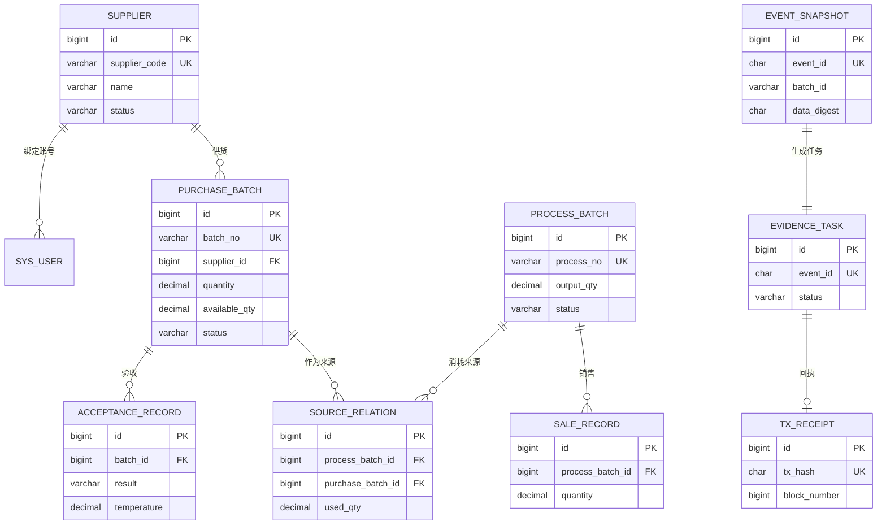

# 数据库设计

> 文档编号：TECH-02 ｜ 版本：v1.0 ｜ 定稿：2026-11-18
> 库名：`meat_trace` ｜ 字符集：`utf8mb4` ｜ 排序：`utf8mb4_0900_ai_ci` ｜ 引擎：InnoDB
> 关联：`TECH-01 架构总览` 5.1、`TECH-04 合约设计`

---

## 1 设计原则

1. **业务表与存证表分离**：业务表服务流程，`event_snapshot` 服务上链与核验，互不侵入。
2. **数量一律 `DECIMAL(12,3)`**：单位统一 kg，保留 3 位小数，**禁止用 float/double**（浮点误差会直接导致摘要不一致）。
3. **状态用字符串枚举而非数字**：可读性优先，便于论文表格与日志排查。
4. **外键真约束**：`source_relation` 与 `purchase_batch` 之间必须由数据库兜底，不能只靠代码。
5. **时间统一 `DATETIME` + 东八区**：摘要里的时间格式固定为 ISO-8601 带偏移，避免时区漂移。

---

## 2 ER 关系



---

## 3 表清单

| # | 表名 | 中文 | 类型 | 任务书写法对应 |
|---|---|---|---|---|
| 1 | `supplier` | 供应商备案 | 主数据 | 供应商 |
| 2 | `sys_user` | 账号与角色 | 支撑 | （任务书隐含：统一管理员/供应商/公开查询者） |
| 3 | `purchase_batch` | 采购批次 | 业务主干 | 采购批次 |
| 4 | `acceptance_record` | 验收记录 | 业务 | 验收记录 |
| 5 | `process_batch` | 加工批次 | 业务主干 | 加工批次 |
| 6 | `source_relation` | 来源关系 | 业务 | 来源关系 |
| 7 | `sale_record` | 销售记录 | 业务 | 销售记录 |
| 8 | `event_snapshot` | 事件快照 | 存证 | 事件快照 |
| 9 | `evidence_task` | 存证任务 | 存证 | 存证任务 |
| 10 | `tx_receipt` | 交易回执 | 存证 | 交易回执 |
| 11 | `audit_log` | 操作审计 | 可选扩展 | — |

---

## 4 表结构

### 4.1 `supplier` 供应商备案

| 字段 | 类型 | 约束 | 说明 |
|---|---|---|---|
| id | BIGINT UNSIGNED | PK, AI | |
| supplier_code | VARCHAR(32) | UNIQUE, NOT NULL | `SUP-0001` |
| name | VARCHAR(100) | NOT NULL | 企业名称 |
| credit_code | VARCHAR(18) | | 统一社会信用代码 |
| license_no | VARCHAR(50) | | 食品经营许可证号 |
| contact_name / contact_phone | VARCHAR(50)/(20) | | 联系人 |
| address | VARCHAR(200) | | 地址 |
| status | VARCHAR(20) | NOT NULL, DEFAULT 'ACTIVE' | `ACTIVE`/`SUSPENDED`/`BLACKLISTED` |
| created_at / updated_at | DATETIME | 自动 | |

### 4.2 `sys_user` 账号与角色

| 字段 | 类型 | 约束 | 说明 |
|---|---|---|---|
| id | BIGINT UNSIGNED | PK | |
| username | VARCHAR(50) | UNIQUE | |
| password_hash | VARCHAR(100) | NOT NULL | BCrypt，禁止明文 |
| display_name | VARCHAR(50) | | |
| role | VARCHAR(20) | CHECK | `ADMIN` 统一管理员 / `SUPPLIER` 供应商 / `VIEWER` 只读监管 |
| supplier_id | BIGINT UNSIGNED | FK → supplier | 角色为 SUPPLIER 时必填 |
| status | TINYINT | DEFAULT 1 | 1 启用 / 0 停用 |

### 4.3 `purchase_batch` 采购批次

| 字段 | 类型 | 约束 | 说明 |
|---|---|---|---|
| id | BIGINT UNSIGNED | PK | |
| batch_no | VARCHAR(40) | UNIQUE | `PB` + yyyyMMdd + 3 位序号 |
| supplier_id | BIGINT UNSIGNED | FK, NOT NULL | |
| meat_type | VARCHAR(30) | NOT NULL | 猪肉/牛肉/羊肉/禽肉 |
| origin | VARCHAR(100) | | 产地 |
| slaughter_no | VARCHAR(50) | | 屠宰批次号 |
| quarantine_no | VARCHAR(60) | | 检疫合格证号 |
| quantity | DECIMAL(12,3) | NOT NULL, CHECK > 0 | 采购数量 |
| available_qty | DECIMAL(12,3) | NOT NULL, CHECK >= 0 | 可用数量，加工时递减 |
| unit | VARCHAR(10) | DEFAULT 'kg' | |
| unit_price | DECIMAL(10,2) | CHECK >= 0 | |
| arrive_time | DATETIME | | 到货时间 |
| cold_chain_temp | DECIMAL(5,2) | | 到货中心温度 ℃ |
| status | VARCHAR(20) | NOT NULL | 见 6.1 |
| created_at / updated_at | DATETIME | | |

**索引**：`uk_batch_no`、`idx_supplier(supplier_id)`、`idx_status(status)`、`idx_quarantine(quarantine_no)`

### 4.4 `acceptance_record` 验收记录

| 字段 | 类型 | 约束 | 说明 |
|---|---|---|---|
| id | BIGINT UNSIGNED | PK | |
| accept_no | VARCHAR(40) | UNIQUE | `AC` + 日期 + 序号 |
| batch_id | BIGINT UNSIGNED | FK, NOT NULL | |
| accept_time | DATETIME | NOT NULL | |
| inspector | VARCHAR(50) | NOT NULL | 验收人 |
| temperature | DECIMAL(5,2) | | 实测中心温度 |
| appearance_ok | TINYINT | CHECK IN (0,1) | 感官是否正常 |
| cert_complete | TINYINT | CHECK IN (0,1) | 索证索票是否齐全 |
| sample_retained | TINYINT | CHECK IN (0,1) | 是否留样 |
| result | VARCHAR(10) | NOT NULL | `PASS` / `FAIL` |
| reject_reason | VARCHAR(200) | | 不合格原因（result=FAIL 必填） |

### 4.5 `process_batch` 加工批次

| 字段 | 类型 | 约束 | 说明 |
|---|---|---|---|
| id | BIGINT UNSIGNED | PK | |
| process_no | VARCHAR(40) | UNIQUE | `PR` + 日期 + 序号（即**追溯码**） |
| meat_type | VARCHAR(30) | NOT NULL | |
| output_qty | DECIMAL(12,3) | NOT NULL, CHECK > 0 | 产出量 |
| available_qty | DECIMAL(12,3) | NOT NULL, CHECK >= 0 | 可售余量 |
| unit | VARCHAR(10) | DEFAULT 'kg' | |
| process_time | DATETIME | NOT NULL | |
| workshop | VARCHAR(50) | | 加工档口 |
| operator | VARCHAR(50) | | 操作人 |
| retain_sample_no | VARCHAR(40) | | 留样编号 |
| status | VARCHAR(20) | NOT NULL | 见 6.2 |

### 4.6 `source_relation` 来源关系（多来源核心）

| 字段 | 类型 | 约束 | 说明 |
|---|---|---|---|
| id | BIGINT UNSIGNED | PK | |
| process_batch_id | BIGINT UNSIGNED | FK, NOT NULL | |
| purchase_batch_id | BIGINT UNSIGNED | FK, NOT NULL | |
| used_qty | DECIMAL(12,3) | NOT NULL, CHECK > 0 | 投入数量 |

**约束**：`UNIQUE uk_process_purchase(process_batch_id, purchase_batch_id)` —— 同一加工批次不得重复引用同一采购批次（这是幂等与数量校验的数据库兜底）。

### 4.7 `sale_record` 销售记录

| 字段 | 类型 | 约束 | 说明 |
|---|---|---|---|
| id | BIGINT UNSIGNED | PK | |
| sale_no | VARCHAR(40) | UNIQUE | `SL` + 日期 + 序号 |
| process_batch_id | BIGINT UNSIGNED | FK, NOT NULL | |
| channel | VARCHAR(30) | | 档口/窗口 |
| quantity | DECIMAL(12,3) | NOT NULL, CHECK > 0 | |
| unit_price | DECIMAL(10,2) | | |
| sale_time | DATETIME | NOT NULL | |
| operator | VARCHAR(50) | | |
| status | VARCHAR(20) | DEFAULT 'NORMAL' | `NORMAL`/`RECALLED` |

### 4.8 `event_snapshot` 事件快照

| 字段 | 类型 | 约束 | 说明 |
|---|---|---|---|
| id | BIGINT UNSIGNED | PK | |
| event_id | CHAR(64) | UNIQUE, NOT NULL | 事件标识：32 位 hex 字符串，业务内生成 |
| batch_id | VARCHAR(40) | NOT NULL | 业务批次号（PB/PR） |
| event_type | VARCHAR(30) | NOT NULL | 见 6.4 |
| biz_time | DATETIME | NOT NULL | 业务发生时间 |
| quantity | DECIMAL(12,3) | | 本事件涉及数量 |
| unit | VARCHAR(10) | | |
| payload_json | JSON | NOT NULL | 规范化后的字段集合 |
| canonical_text | TEXT | NOT NULL | 拼好的规范串（**核验时按此重算**） |
| data_digest | CHAR(64) | NOT NULL | SHA-256(canonical_text) 小写 hex |
| schema_version | VARCHAR(10) | DEFAULT 'v1' | 摘要规范版本 |
| created_at | DATETIME | 自动 | |

**索引**：`uk_event_id`、`idx_batch(batch_id)`、`idx_type_time(event_type, biz_time)`

> `canonical_text` 必须落库。核验时不能"重新拼一遍"——字段顺序、数字格式一旦随代码迭代变化，历史事件会全部误判为不一致。

### 4.9 `evidence_task` 存证任务

| 字段 | 类型 | 约束 | 说明 |
|---|---|---|---|
| id | BIGINT UNSIGNED | PK | |
| event_id | CHAR(64) | UNIQUE, NOT NULL | 与快照 1:1 |
| status | VARCHAR(20) | NOT NULL | 见 6.3 |
| retry_count | INT | DEFAULT 0 | |
| next_retry_at | DATETIME | | 退避重试（1s/5s/30s/5min） |
| last_error | VARCHAR(500) | | |
| created_at / updated_at | DATETIME | | |

### 4.10 `tx_receipt` 交易回执

| 字段 | 类型 | 约束 | 说明 |
|---|---|---|---|
| id | BIGINT UNSIGNED | PK | |
| event_id | CHAR(64) | NOT NULL, INDEX | |
| tx_hash | CHAR(66) | UNIQUE | `0x` + 64 hex |
| block_number | BIGINT | | 区块高度 |
| block_hash | CHAR(66) | | |
| contract_address | VARCHAR(66) | | 部署地址 |
| tx_status | VARCHAR(10) | | `0x0` 成功 |
| gas_used | BIGINT | | |
| submitter_address | VARCHAR(66) | | 统一演示账户地址 |
| raw_receipt | JSON | | 原始回执留痕 |
| receipt_time | DATETIME | | |

### 4.11 `audit_log` 操作审计（可选扩展）

`id / user_id / action / target_type / target_id / detail JSON / ip / created_at`

---

## 5 完整 DDL

> 落地文件：`db/migration/V1__init.sql`（Flyway 版本化，命名不可改）

```sql
SET NAMES utf8mb4;

CREATE TABLE supplier (
  id              BIGINT UNSIGNED NOT NULL AUTO_INCREMENT,
  supplier_code   VARCHAR(32)  NOT NULL COMMENT '供应商编码 SUP-0001',
  name            VARCHAR(100) NOT NULL COMMENT '企业名称',
  credit_code     VARCHAR(18)  DEFAULT NULL COMMENT '统一社会信用代码',
  license_no      VARCHAR(50)  DEFAULT NULL COMMENT '食品经营许可证号',
  contact_name    VARCHAR(50)  DEFAULT NULL,
  contact_phone   VARCHAR(20)  DEFAULT NULL,
  address         VARCHAR(200) DEFAULT NULL,
  status          VARCHAR(20)  NOT NULL DEFAULT 'ACTIVE',
  created_at      DATETIME     NOT NULL DEFAULT CURRENT_TIMESTAMP,
  updated_at      DATETIME     NOT NULL DEFAULT CURRENT_TIMESTAMP ON UPDATE CURRENT_TIMESTAMP,
  PRIMARY KEY (id),
  UNIQUE KEY uk_supplier_code (supplier_code),
  CONSTRAINT ck_supplier_status CHECK (status IN ('ACTIVE','SUSPENDED','BLACKLISTED'))
) ENGINE=InnoDB DEFAULT CHARSET=utf8mb4 COMMENT='供应商备案';

CREATE TABLE sys_user (
  id            BIGINT UNSIGNED NOT NULL AUTO_INCREMENT,
  username      VARCHAR(50)  NOT NULL,
  password_hash VARCHAR(100) NOT NULL,
  display_name  VARCHAR(50)  NOT NULL,
  role          VARCHAR(20)  NOT NULL,
  supplier_id   BIGINT UNSIGNED DEFAULT NULL,
  status        TINYINT      NOT NULL DEFAULT 1,
  created_at    DATETIME     NOT NULL DEFAULT CURRENT_TIMESTAMP,
  updated_at    DATETIME     NOT NULL DEFAULT CURRENT_TIMESTAMP ON UPDATE CURRENT_TIMESTAMP,
  PRIMARY KEY (id),
  UNIQUE KEY uk_user_username (username),
  KEY idx_user_supplier (supplier_id),
  CONSTRAINT fk_user_supplier FOREIGN KEY (supplier_id) REFERENCES supplier (id),
  CONSTRAINT ck_user_role CHECK (role IN ('ADMIN','SUPPLIER','VIEWER'))
) ENGINE=InnoDB DEFAULT CHARSET=utf8mb4 COMMENT='账号与角色';

CREATE TABLE purchase_batch (
  id              BIGINT UNSIGNED NOT NULL AUTO_INCREMENT,
  batch_no        VARCHAR(40)  NOT NULL COMMENT 'PB+yyyyMMdd+3位',
  supplier_id     BIGINT UNSIGNED NOT NULL,
  meat_type       VARCHAR(30)  NOT NULL,
  origin          VARCHAR(100) DEFAULT NULL,
  slaughter_no    VARCHAR(50)  DEFAULT NULL,
  quarantine_no   VARCHAR(60)  DEFAULT NULL,
  quantity        DECIMAL(12,3) NOT NULL,
  available_qty   DECIMAL(12,3) NOT NULL,
  unit            VARCHAR(10)  NOT NULL DEFAULT 'kg',
  unit_price      DECIMAL(10,2) DEFAULT NULL,
  arrive_time     DATETIME     DEFAULT NULL,
  cold_chain_temp DECIMAL(5,2) DEFAULT NULL,
  status          VARCHAR(20)  NOT NULL DEFAULT 'PENDING_ACCEPT',
  created_at      DATETIME     NOT NULL DEFAULT CURRENT_TIMESTAMP,
  updated_at      DATETIME     NOT NULL DEFAULT CURRENT_TIMESTAMP ON UPDATE CURRENT_TIMESTAMP,
  PRIMARY KEY (id),
  UNIQUE KEY uk_purchase_batch_no (batch_no),
  KEY idx_purchase_supplier (supplier_id),
  KEY idx_purchase_status (status),
  KEY idx_purchase_quarantine (quarantine_no),
  CONSTRAINT fk_purchase_supplier FOREIGN KEY (supplier_id) REFERENCES supplier (id),
  CONSTRAINT ck_purchase_qty CHECK (quantity > 0),
  CONSTRAINT ck_purchase_avail CHECK (available_qty >= 0 AND available_qty <= quantity),
  CONSTRAINT ck_purchase_status CHECK (status IN ('PENDING_ACCEPT','PASSED','REJECTED','CLOSED'))
) ENGINE=InnoDB DEFAULT CHARSET=utf8mb4 COMMENT='采购批次';

CREATE TABLE acceptance_record (
  id              BIGINT UNSIGNED NOT NULL AUTO_INCREMENT,
  accept_no       VARCHAR(40)  NOT NULL,
  batch_id        BIGINT UNSIGNED NOT NULL,
  accept_time     DATETIME     NOT NULL,
  inspector       VARCHAR(50)  NOT NULL,
  temperature     DECIMAL(5,2) DEFAULT NULL,
  appearance_ok   TINYINT      NOT NULL DEFAULT 1,
  cert_complete   TINYINT      NOT NULL DEFAULT 1,
  sample_retained TINYINT      NOT NULL DEFAULT 0,
  result          VARCHAR(10)  NOT NULL,
  reject_reason   VARCHAR(200) DEFAULT NULL,
  created_at      DATETIME     NOT NULL DEFAULT CURRENT_TIMESTAMP,
  PRIMARY KEY (id),
  UNIQUE KEY uk_accept_no (accept_no),
  KEY idx_accept_batch (batch_id),
  CONSTRAINT fk_accept_batch FOREIGN KEY (batch_id) REFERENCES purchase_batch (id),
  CONSTRAINT ck_accept_result CHECK (result IN ('PASS','FAIL'))
) ENGINE=InnoDB DEFAULT CHARSET=utf8mb4 COMMENT='验收记录';

CREATE TABLE process_batch (
  id               BIGINT UNSIGNED NOT NULL AUTO_INCREMENT,
  process_no       VARCHAR(40)  NOT NULL COMMENT 'PR+yyyyMMdd+3位，即追溯码',
  meat_type        VARCHAR(30)  NOT NULL,
  output_qty       DECIMAL(12,3) NOT NULL,
  available_qty    DECIMAL(12,3) NOT NULL,
  unit             VARCHAR(10)  NOT NULL DEFAULT 'kg',
  process_time     DATETIME     NOT NULL,
  workshop         VARCHAR(50)  DEFAULT NULL,
  operator         VARCHAR(50)  DEFAULT NULL,
  retain_sample_no VARCHAR(40)  DEFAULT NULL,
  status           VARCHAR(20)  NOT NULL DEFAULT 'CREATED',
  created_at       DATETIME     NOT NULL DEFAULT CURRENT_TIMESTAMP,
  updated_at       DATETIME     NOT NULL DEFAULT CURRENT_TIMESTAMP ON UPDATE CURRENT_TIMESTAMP,
  PRIMARY KEY (id),
  UNIQUE KEY uk_process_no (process_no),
  KEY idx_process_status (status),
  CONSTRAINT ck_process_qty CHECK (output_qty > 0),
  CONSTRAINT ck_process_avail CHECK (available_qty >= 0 AND available_qty <= output_qty),
  CONSTRAINT ck_process_status CHECK (status IN ('CREATED','ON_SALE','SOLD_OUT','ABNORMAL','RECALLED','CLOSED'))
) ENGINE=InnoDB DEFAULT CHARSET=utf8mb4 COMMENT='加工批次';

CREATE TABLE source_relation (
  id                BIGINT UNSIGNED NOT NULL AUTO_INCREMENT,
  process_batch_id  BIGINT UNSIGNED NOT NULL,
  purchase_batch_id BIGINT UNSIGNED NOT NULL,
  used_qty          DECIMAL(12,3) NOT NULL,
  created_at        DATETIME NOT NULL DEFAULT CURRENT_TIMESTAMP,
  PRIMARY KEY (id),
  UNIQUE KEY uk_process_purchase (process_batch_id, purchase_batch_id),
  KEY idx_source_purchase (purchase_batch_id),
  CONSTRAINT fk_source_process FOREIGN KEY (process_batch_id) REFERENCES process_batch (id),
  CONSTRAINT fk_source_purchase FOREIGN KEY (purchase_batch_id) REFERENCES purchase_batch (id),
  CONSTRAINT ck_source_used CHECK (used_qty > 0)
) ENGINE=InnoDB DEFAULT CHARSET=utf8mb4 COMMENT='加工批次来源关系';

CREATE TABLE sale_record (
  id               BIGINT UNSIGNED NOT NULL AUTO_INCREMENT,
  sale_no          VARCHAR(40)  NOT NULL,
  process_batch_id BIGINT UNSIGNED NOT NULL,
  channel          VARCHAR(30)  DEFAULT NULL,
  quantity         DECIMAL(12,3) NOT NULL,
  unit_price       DECIMAL(10,2) DEFAULT NULL,
  sale_time        DATETIME     NOT NULL,
  operator         VARCHAR(50)  DEFAULT NULL,
  status           VARCHAR(20)  NOT NULL DEFAULT 'NORMAL',
  created_at       DATETIME     NOT NULL DEFAULT CURRENT_TIMESTAMP,
  PRIMARY KEY (id),
  UNIQUE KEY uk_sale_no (sale_no),
  KEY idx_sale_process (process_batch_id),
  CONSTRAINT fk_sale_process FOREIGN KEY (process_batch_id) REFERENCES process_batch (id),
  CONSTRAINT ck_sale_qty CHECK (quantity > 0),
  CONSTRAINT ck_sale_status CHECK (status IN ('NORMAL','RECALLED'))
) ENGINE=InnoDB DEFAULT CHARSET=utf8mb4 COMMENT='销售记录';

CREATE TABLE event_snapshot (
  id             BIGINT UNSIGNED NOT NULL AUTO_INCREMENT,
  event_id       CHAR(64)     NOT NULL COMMENT '32位hex业务事件标识',
  batch_id       VARCHAR(40)  NOT NULL,
  event_type     VARCHAR(30)  NOT NULL,
  biz_time       DATETIME     NOT NULL,
  quantity       DECIMAL(12,3) DEFAULT NULL,
  unit           VARCHAR(10)  DEFAULT NULL,
  payload_json   JSON         NOT NULL,
  canonical_text TEXT         NOT NULL COMMENT '规范化原串，核验按此重算',
  data_digest    CHAR(64)     NOT NULL COMMENT 'SHA-256 小写hex',
  schema_version VARCHAR(10)  NOT NULL DEFAULT 'v1',
  created_at     DATETIME     NOT NULL DEFAULT CURRENT_TIMESTAMP,
  PRIMARY KEY (id),
  UNIQUE KEY uk_event_id (event_id),
  KEY idx_snapshot_batch (batch_id),
  KEY idx_snapshot_type_time (event_type, biz_time)
) ENGINE=InnoDB DEFAULT CHARSET=utf8mb4 COMMENT='事件快照';

CREATE TABLE evidence_task (
  id            BIGINT UNSIGNED NOT NULL AUTO_INCREMENT,
  event_id      CHAR(64)    NOT NULL,
  status        VARCHAR(20) NOT NULL DEFAULT 'PENDING',
  retry_count   INT         NOT NULL DEFAULT 0,
  next_retry_at DATETIME    DEFAULT NULL,
  last_error    VARCHAR(500) DEFAULT NULL,
  created_at    DATETIME    NOT NULL DEFAULT CURRENT_TIMESTAMP,
  updated_at    DATETIME    NOT NULL DEFAULT CURRENT_TIMESTAMP ON UPDATE CURRENT_TIMESTAMP,
  PRIMARY KEY (id),
  UNIQUE KEY uk_task_event (event_id),
  KEY idx_task_status (status, next_retry_at),
  CONSTRAINT ck_task_status CHECK (status IN ('PENDING','SUBMITTED','CONFIRMED','FAILED','UNREACHABLE','CONFLICT'))
) ENGINE=InnoDB DEFAULT CHARSET=utf8mb4 COMMENT='存证任务';

CREATE TABLE tx_receipt (
  id                BIGINT UNSIGNED NOT NULL AUTO_INCREMENT,
  event_id          CHAR(64)    NOT NULL,
  tx_hash           CHAR(66)    NOT NULL,
  block_number      BIGINT      DEFAULT NULL,
  block_hash        CHAR(66)    DEFAULT NULL,
  contract_address  VARCHAR(66) DEFAULT NULL,
  tx_status         VARCHAR(10) DEFAULT NULL,
  gas_used          BIGINT      DEFAULT NULL,
  submitter_address VARCHAR(66) DEFAULT NULL,
  raw_receipt       JSON        DEFAULT NULL,
  receipt_time      DATETIME    DEFAULT NULL,
  created_at        DATETIME    NOT NULL DEFAULT CURRENT_TIMESTAMP,
  PRIMARY KEY (id),
  UNIQUE KEY uk_receipt_tx (tx_hash),
  KEY idx_receipt_event (event_id)
) ENGINE=InnoDB DEFAULT CHARSET=utf8mb4 COMMENT='交易回执';

CREATE TABLE audit_log (
  id          BIGINT UNSIGNED NOT NULL AUTO_INCREMENT,
  user_id     BIGINT UNSIGNED DEFAULT NULL,
  action      VARCHAR(50)  NOT NULL,
  target_type VARCHAR(30)  DEFAULT NULL,
  target_id   VARCHAR(50)  DEFAULT NULL,
  detail      JSON         DEFAULT NULL,
  ip          VARCHAR(45)  DEFAULT NULL,
  created_at  DATETIME     NOT NULL DEFAULT CURRENT_TIMESTAMP,
  PRIMARY KEY (id),
  KEY idx_audit_user_time (user_id, created_at)
) ENGINE=InnoDB DEFAULT CHARSET=utf8mb4 COMMENT='操作审计';
```

---

## 6 状态字典

### 6.1 `purchase_batch.status`

| 值 | 中文 | 可进入条件 | 允许的下一步 |
|---|---|---|---|
| `PENDING_ACCEPT` | 待验收 | 采购单创建 | PASSED / REJECTED |
| `PASSED` | 验收合格 | 验收 result=PASS | 可被加工消耗；全部消耗后 CLOSED |
| `REJECTED` | 验收不合格 | 验收 result=FAIL | **限制流转**，禁止加工与销售 |
| `CLOSED` | 已结案 | `available_qty = 0` | 终态 |

### 6.2 `process_batch.status`

| 值 | 中文 | 说明 |
|---|---|---|
| `CREATED` | 已加工 | 投料完成，未上架 |
| `ON_SALE` | 在售 | 允许销售 |
| `SOLD_OUT` | 售罄 | `available_qty = 0` |
| `ABNORMAL` | 异常冻结 | 冷链超标/抽检异常，暂停销售 |
| `RECALLED` | 已召回 | 所有销售记录置 `RECALLED` |
| `CLOSED` | 已结案 | 终态 |

### 6.3 `evidence_task.status`

| 值 | 中文 | 含义 |
|---|---|---|
| `PENDING` | 待提交 | 已入队，未发送 |
| `SUBMITTED` | 已发送 | 已提交，未拿回执 |
| `CONFIRMED` | 已确认 | 有回执且 tx_status=0x0 |
| `FAILED` | 失败 | 合约拒绝或确定性错误，需人工处理 |
| `UNREACHABLE` | 结果不可达 | 超时/网络问题，**先查链再决定** |
| `CONFLICT` | 内容冲突 | 同 eventId 不同摘要，需人工介入 |

### 6.4 `event_type` 枚举（9 类）

| 值 | 触发点 | 关键字段 |
|---|---|---|
| `SUPPLIER_REG` | 供应商备案/变更 | supplierCode, name, licenseNo |
| `PURCHASE_CREATE` | 采购批次创建 | batchNo, supplierCode, quantity, quarantineNo |
| `ACCEPT_RESULT` | 验收完成 | acceptNo, result, temperature, inspector |
| `COLD_CHAIN` | 冷链温控登记 | temperature, transportNo, segment |
| `PROCESS_CREATE` | 加工投料 | processNo, sources[], outputQty, retainSampleNo |
| `SALE_CREATE` | 销售登记 | saleNo, processNo, quantity, channel |
| `DISPOSAL` | 异常处置 | abnormalType, action, handler, conclusion |
| `RECALL` | 召回 | processNo, reason, scope, affectedSales |
| `STOCK_CHECK` | 留样/库存核查（可选） | sampleNo, checkResult |

### 6.5 核验状态（计算结果，不落库）

`MATCHED` / `MISMATCHED` / `UNCONFIRMED` / `UNREACHABLE`（判定逻辑见 `TECH-01` 5.3）

---

## 7 事务边界

**必须同一个 `@Transactional` 方法内的三类写入**：

```
① 业务表（purchase_batch / acceptance_record / process_batch / source_relation / sale_record）
② event_snapshot
③ evidence_task(status=PENDING)
```

原因：若业务落库成功而快照丢失，则这条业务永远无法被核验；若快照写入而任务丢失，则该事件永远不会上链。三者必须同生共死。

**不在事务内做的事**：

| 操作 | 原因 | 放置位置 |
|---|---|---|
| 调用 WeBASE-Front 上链 | 网络耗时 100ms~2s，长事务会锁表 | 异步工作器 |
| 计算 SHA-256 | 纯 CPU，很快，**放事务内**（保证与业务数据一致） | Service |
| 写 `tx_receipt` | 上链结果在事务之后才产生 | 工作器独立事务 |

**数量扣减的并发控制**：`UPDATE purchase_batch SET available_qty = available_qty - #{qty} WHERE id = #{id} AND available_qty >= #{qty}`，用受影响行数判断是否成功（乐观扣减，避免 `SELECT ... FOR UPDATE` 的行锁等待）。

---

## 8 业务规则编号表（测试用例直接引用）

| 编号 | 规则 | 违反时的错误码 |
|---|---|---|
| BR-01 | 只有 `PASSED` 的采购批次可被加工消耗 | 40902 |
| BR-02 | 单个加工批次投入总量 ≤ Σ 各来源批次 `available_qty` | 40901 |
| BR-03 | 同一加工批次不得重复引用同一采购批次 | 40903 |
| BR-04 | `REJECTED` 批次禁止进入加工与销售 | 40902 |
| BR-05 | 加工产出量 ≤ 投入总量（出品率不得大于 1） | 40001 |
| BR-06 | 只有 `ON_SALE` 的加工批次可销售 | 40902 |
| BR-07 | 累计销售 ≤ `available_qty` | 40901 |
| BR-08 | 到货/运输温度超出品类阈值 → 生成 `COLD_CHAIN` 异常并可选冻结 | 40001 |
| BR-09 | 召回后该批次全部销售记录置 `RECALLED`，禁止继续销售 | 40902 |
| BR-10 | 同一 `requestId` 24h 内重复提交 → 返回首次结果，不新建记录 | 40903 |
| BR-11 | 同 `eventId` + 同摘要 → 幂等，链上返回 1，不新增事件 | — |
| BR-12 | 同 `eventId` + 异摘要 → 冲突，链上返回 2，**保留原记录** | 40905 |
| BR-13 | 业务/快照/任务必须同事务提交 | — |
| BR-14 | 上链超时先按 `eventId` 查链，查到同类即确认，查不到才重试 | — |
| BR-15 | 核验状态与检验结论分栏展示，不得合并 | — |

---

## 9 容量与性能估算（答辩常问）

| 项 | 估算 | 依据 |
|---|---|---|
| 日采购批次 | 5~10 | 一所高校食堂日均肉类采购 |
| 单批次事件数 | 6~10 | 采购/验收/冷链/加工/销售/处置 |
| 年事件量 | ~2.5 万 | 10 × 8 × 300 天 |
| 单条快照存储 | ~2 KB | canonical_text + JSON |
| 单条链上记录 | ~200 B | 合约 5 个字段 |
| 5 年链上占用 | ~25 MB | 完全不构成压力，故无需分片 |

> 这正是"链上只存摘要"的经济学依据：如果全量字段上链，5 年会到 GB 级，而收益仅是省一次数据库查询。
