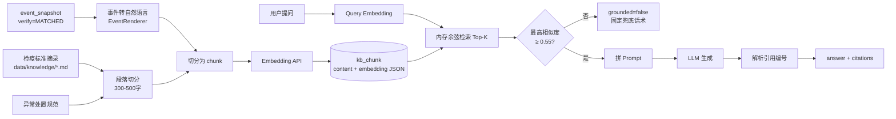

# AI 问答模块设计

> 文档编号：TECH-09 ｜ 版本：v1.0 ｜ 定稿：2026-11-18
> 定位：主线之外的**扩展模块**，可一键关闭，不影响溯源主流程
> 服务文档：5.x「智能溯源问答」

---

## 1 为什么加这个模块

溯源系统把数据做可信了，但用户仍然看不懂：一个批次有 6~10 条事件，每条十几个字段。用户真正想问的是"这批肉的检疫结论是什么""这个供应商出过几次问题"。

**RAG 与区块链在本项目里是同一个命题的两种解法**：

| | 区块链存证 | RAG 问答 |
|---|---|---|
| 解决的问题 | 数据写完有没有被改 | 答案有没有出处 |
| 手段 | 摘要上链，可重算比对 | 引用回链，可点开核验 |
| 失败时 | 显示「记录不一致」 | 回答「未找到依据」 |

所以这不是"为了凑一个 AI 模块"，而是把"可信"这个主题往前推了一步。

---

## 2 边界（写进代码也写进文档）

| 做 | 不做 |
|---|---|
| 基于**已确认上链且核验一致**的事件回答问题 | 不做图像识别、不做预测、不做质量判定 |
| 每个结论必须带引用 | 不允许无引用作答 |
| 引用可点击跳转到事件详情 | 不生成不存在的批次号、证号、数量 |
| 无依据时明确说找不到 | 不猜测、不"根据常识推断" |

**最硬的一条**：知识库只收录 `verifyStatus = MATCHED` 的事件。`MISMATCHED`（记录被改过）与 `UNREACHABLE`（核不了）的批次**不参与任何问答**。

> 这句话是最值得强调的一句："我只回答我能证明的部分。"

---

## 3 总体链路



---

## 4 知识库构建

### 4.1 数据源与筛选

| 来源 | 筛选条件 | 说明 |
|---|---|---|
| 事件快照 | `verifyStatus = MATCHED` | 主来源，每条事件渲染成一段自然语言 |
| 检疫标准摘录 | 人工整理，存 `data/knowledge/standards.md` | 提供"什么样的温度算超标"这类背景知识 |
| 异常处置规范 | `data/knowledge/disposal.md` | 提供"召回流程是什么"这类流程知识 |

**事件转自然语言（`EventRenderer`）** —— 不要直接把 JSON 丢进向量库，模型对 JSON 的语义理解很差：

```
2026-11-18 09:30，采购批次 PB20261118001（猪肉，120.000 kg，供应商：××食品有限公司）
完成入库验收。验收人李四，到货中心温度 3.500 ℃，感官正常，索证索票齐全，已留样。
检疫合格证号 JY-360100-20261118-0042，检验结论：合格。
```

每段固定带上：时间、批次号、品类、数量单位、关键结论。这四样是用户提问时最常出现的锚点。

### 4.2 切分策略

| 类型 | 切法 | 参数 |
|---|---|---|
| 事件 | **一事件一段，不再切** | 单段 80–200 字 |
| 标准/规范文档 | 按二级标题分段，超长再按句号切 | 300–500 字，重叠 50 字 |
| 表格类内容 | 先转成"字段：值"的句子再入库 | 避免表格结构丢失 |

**为什么事件不切**：一条事件是一个语义整体，切开会出现"温度 3.5℃"和"这是哪一批"分离的情况，检索时反而找不到。

### 4.3 辅助表 `kb_chunk`

> 迁移文件：`db/migration/V3__ai.sql`（模块关闭时不执行）

```sql
CREATE TABLE kb_chunk (
  id            BIGINT UNSIGNED NOT NULL AUTO_INCREMENT,
  source_type   VARCHAR(20)  NOT NULL COMMENT 'EVENT/STANDARD/DISPOSAL',
  source_id     VARCHAR(64)  NOT NULL COMMENT 'eventId 或文档编号',
  batch_id      VARCHAR(40)  DEFAULT NULL,
  chunk_index   INT          NOT NULL DEFAULT 0,
  content       TEXT         NOT NULL,
  content_hash  CHAR(64)     NOT NULL COMMENT '内容哈希，用于增量重建',
  embedding     JSON         DEFAULT NULL COMMENT 'float 数组，维度随模型',
  model         VARCHAR(50)  DEFAULT NULL,
  created_at    DATETIME     NOT NULL DEFAULT CURRENT_TIMESTAMP,
  PRIMARY KEY (id),
  UNIQUE KEY uk_chunk (source_type, source_id, chunk_index),
  KEY idx_chunk_batch (batch_id)
) ENGINE=InnoDB DEFAULT CHARSET=utf8mb4 COMMENT='问答知识库片段';
```

**增量重建**：按 `content_hash` 比对，内容没变就跳过，避免每次全量重算 embedding（省钱也省时间）。

---

## 5 检索

### 5.1 为什么不用向量数据库

| 方案 | 部署成本 | 检索延迟（1 万条 × 1024 维） | 结论 |
|---|---|---|---|
| Milvus / Qdrant | 多一个容器 + 内存 1G+ | ~5 ms | 过度设计 |
| Elasticsearch | 多一个 JVM，虚拟机扛不住 | ~10 ms | 更重 |
| **MySQL 存 + 内存暴力余弦** | 0 | **~35 ms** | **采用** |

估算：1 万条 × 1024 维 float = 40 MB 内存，单次查询做 1 万次点积，Java 在 2 核机器上约 35 ms。**在演示规模下，暴力检索比任何近似算法都准，而且没有召回损失。**

要写明这条取舍的适用边界：**超过 10 万条应考虑 HNSW**。

### 5.2 检索参数

| 参数 | 值 | 说明 |
|---|---|---|
| `topK` | 5 | 默认；接口可传 1–10 |
| 相似度阈值 | 0.55 | 低于此值视为"无依据" |
| 相似度 | 余弦（向量已归一化，等价于点积） | |
| 过滤 | 先按 `batch_id` 命中则加权 +0.1 | 问题里出现批次号时优先该批次 |

### 5.3 重排规则

纯向量相似度会被"长度长、信息多"的片段占便宜。加两条轻量规则：

1. **批次号精确命中加权**：问题中出现 `PB`/`PR` 开头的批次号且片段属于该批次 → `score += 0.1`
2. **时间新鲜度微调**：同一批次内，`bizTime` 较晚的事件 → `score += 0.02`（只做弱排序，避免把历史关键事件挤掉）

---

## 6 Prompt 设计

```
你是高校食堂肉类溯源系统的查询助手。你只能依据下面提供的【资料片段】回答。

规则：
1. 每个结论后面必须标注来源编号，格式如 [1][2]；没有编号的结论视为无效。
2. 资料片段里没有的信息，直接回答"未在已核验记录中找到依据"，禁止推测或补充常识。
3. 不要评价食品是否安全，只陈述记录中写了什么。安全与否以检验结论字段为准。
4. 涉及数量必须带单位，涉及时间必须带日期。
5. 如果多个批次的数据被问到，分条列出，不要合并成一个数。

【资料片段】
[1] (eventId=6f1c…0718, 批次=PB20261118001, 类型=入库验收, 时间=2026-11-18 09:30, 核验=一致)
2026-11-18 09:30，采购批次 PB20261118001（猪肉，120.000 kg…）完成入库验收……
[2] …

【问题】{question}
【回答】
```

**为什么规则 2 要写死**：LLM 在检索为空时极其倾向于"合理编造"。这是 RAG 最常见的翻车方式，必须在 Prompt 层 + 代码层双保险（代码层见第 7 节）。

---

## 7 引用回链机制

### 7.1 引用结构

```json
{
  "index": 1,
  "eventId": "6f1c2b9a…0718",
  "batchId": "PB20261118001",
  "eventType": "ACCEPT_RESULT",
  "verifyStatus": "MATCHED",
  "score": 0.83
}
```

`verifyStatus` 必须随引用一起返回——用户点开引用时，要能看到"这条记录现在是核验一致的"。如果用户在问答之后、点开之前这段时间里该记录变成了 `MISMATCHED`，详情页会如实显示红色状态。

### 7.2 `grounded` 判定（代码层，不依赖模型自觉）

```java
boolean grounded = false;
if (!citations.isEmpty()) {
    double maxScore = citations.stream().mapToDouble(Citation::getScore).max().orElse(0);
    boolean answerHasMarker = answer.matches(".*\\[\\d+\\].*");
    grounded = maxScore >= 0.55 && answerHasMarker;
}
if (!grounded) {
    answer = "未在已核验记录中找到依据。";
    citations = Collections.emptyList();
}
```

**三重条件缺一不可**：有引用、相似度够、答案里真的标了编号。只信模型说"我引用了"是不行的。

### 7.3 引用解析

从答案里正则提取 `\[(\d+)\]`，映射回检索时的片段顺序。若提取到的编号超出片段范围 → 该编号丢弃，并在日志里记一条 `hallucinated-citation`。

> 这个日志字段是评测"答非所问率"的依据，不是可选项。

---

## 8 评测设计

### 8.1 评测集（20 条）

| 类型 | 条数 | 示例 |
|---|---|---|
| 单批次事实 | 8 | "PB20261118001 的检疫结论是什么" |
| 跨批次对比 | 3 | "这个月哪几批猪肉冷链温度超标过" |
| 供应商维度 | 3 | "××食品有限公司今年出过几次问题" |
| 流程规则 | 2 | "召回之后还能继续卖吗" |
| **无依据（应拒答）** | 3 | "PB20261119009 的检疫证号是多少"（该批次不存在） |
| **越界（应拒答）** | 1 | "这批肉吃了安全吗"（安全问题，系统不判定） |

> 最后 4 条是重点。一个只会在有答案时答对的系统不可信，**会拒答的系统才可信**。

### 8.2 指标定义

| 指标 | 定义 | 目标 |
|---|---|---|
| 检索召回率 R@5 | 人工标注的"应命中事件"出现在 Top-5 的比例 | ≥ 0.85 |
| 引用命中率 | 返回的 `eventId` 全部落在标注集合内的比例 | ≥ 0.90 |
| 答案正确率 | 人工逐条判定"事实无误且无多余推断" | ≥ 0.80 |
| 拒答正确率 | 4 条应拒答中正确拒答的比例 | = 1.00 |
| 平均延迟 | 检索 + 生成端到端 | ≤ 3 s |

**拒答正确率要求 100%**：这是唯一一条不允许打折的指标。答错一句"没找到"没有代价，编一个假证号有代价。

### 8.3 评测执行

```bash
# 评测集：data/knowledge/eval_set.jsonl（一行一条）
# 输出：docs/tech/08-测试记录.md 表 6-x
java -jar target/meat-trace.jar --eval=assistant --eval-file=data/knowledge/eval_set.jsonl
```

---

## 9 降级与开关

| 层 | 开关 | 降级行为 |
|---|---|---|
| 全局 | `assistant.enabled=false` | 前端隐藏入口，接口返回 404 |
| 检索 | 索引未构建 | 返回 `50301 索引未就绪` |
| 模型 | `llm.api-key` 缺失或欠费 | 返回 `50003`，只给检索片段不给结论 |
| 超时 | > 8 s | 中断生成，返回已检索片段 + "生成超时" |

**评审保险**：演示前把问答的 3 个典型问题各跑一遍并录屏。API 欠费、网络抖动都不影响你讲。

---

## 10 成本估算

| 项 | 单价（参考） | 用量 | 月成本 |
|---|---|---|---|
| Embedding（建库） | ~0.0005 元/千 token | 500 条 × 200 token ≈ 10 万 token | ≈ 0.05 元 |
| Embedding（增量） | 同上 | 每天 50 条 | ≈ 0.4 元 |
| 生成（问答） | ~0.001 元/千 token | 每天 50 次 × 1500 token | ≈ 2.3 元 |
| **合计** | | | **< 5 元/月** |

> 演示与评测阶段的真实花费在 10 元以内。配置里写 `llm.monthly-budget=50`，超限自动关闭。

---

## 11 与文档的对应

| 章节 | 取材 |
|---|---|
| 5.x.1 模块定位与边界 | 本文第 1、2 节 |
| 5.x.2 知识库构建 | 第 4 节 |
| 5.x.3 检索与生成 | 第 5、6 节 |
| 5.x.4 引用回链与可信约束 | 第 7 节 |
| 5.x.5 评测结果 | 第 8 节 + `TECH-08` 表 6-x |
| 7.x 展望 | 第 9 节（未做的：重排模型、多轮对话） |

> 要把"扩展模块"这个定位说清楚：主线（需求范围）不受影响，本模块可关闭。这样主次分明，也交代了增量工作的性质。
